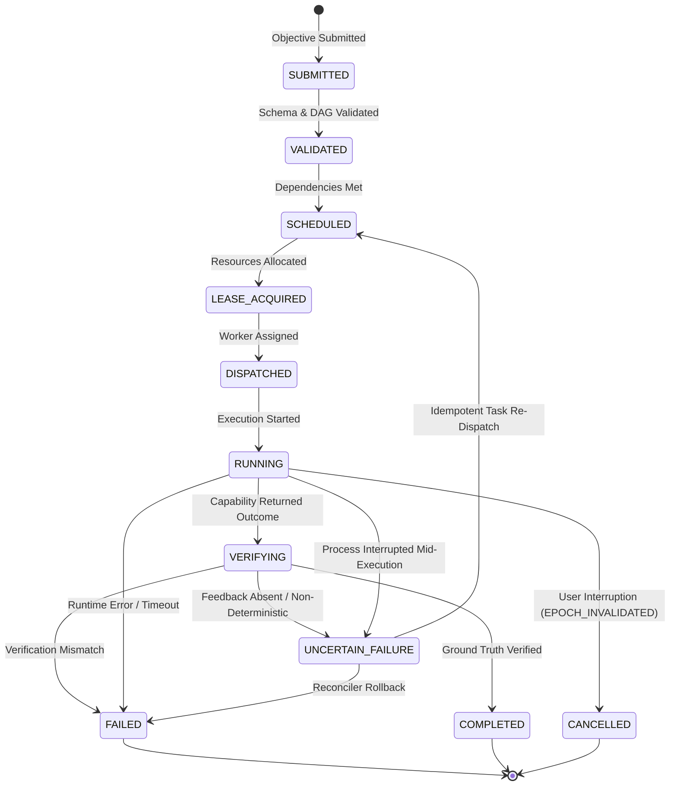
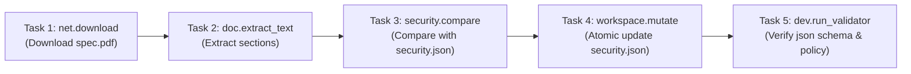
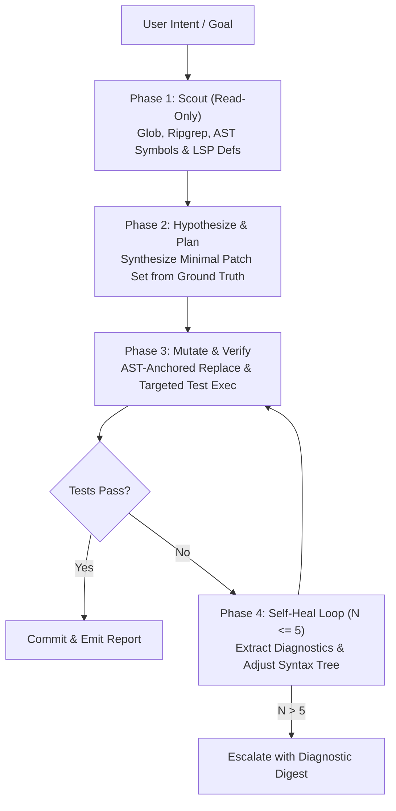
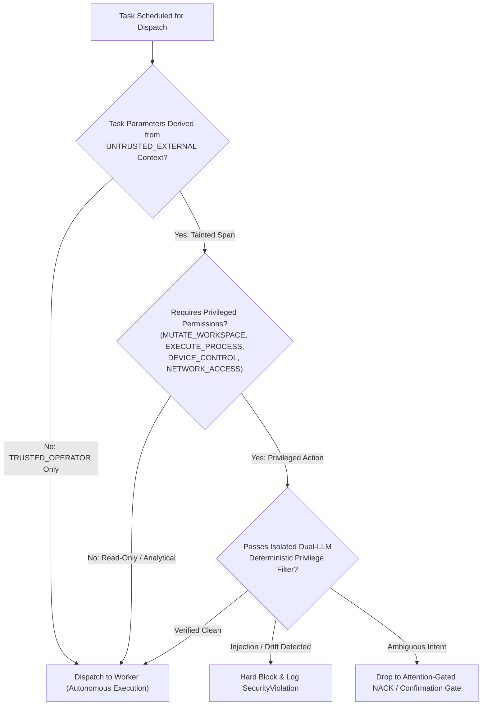

# EXECUTION KERNEL SPECIFICATION (VECTOR CORE)

> **Subsystem:** EON Deterministic Execution Engine  
> **Module:** `engine/core-rs/crates/eon-kernel`  
> **Derived from:** Vector Generation 2 Deterministic Architecture + Ciel Autonomous Execution Engine

---

## 1. Core Principles & Separation

In EON, **cognition and execution are strictly decoupled**:
- **Cognition (Ciel)** answers: *What needs to be done?* It synthesizes human intent into a structured **Objective** and an adaptive, dependency-checked **Workflow DAG**.
- **The Execution Kernel (Vector Engine)** answers: *How can this be executed with maximum efficiency, deterministic safety, resource accounting, and crash resilience?*

The Execution Kernel owns scheduling, task dispatch, atomic resource leases, event journaling, state persistence, error isolation, saga rollbacks, and crash recovery.

---

## 2. Canonical Dependency Levels (0 through 5)

Dependencies flow strictly downward. Lower levels never import or depend on types from higher levels:

```text
Level 5: Advanced Intelligence (Ciel Cognition)
         - ObjectiveWorkflowCompiler, WorkflowSynthesizer, WorkflowOptimizer
         ▲
Level 4: Capability Fabric
         - CapabilityRegistry, ToolProviders, SecuritySandboxes, DynamicPlugins
         ▲
Level 3: Execution Engine
         - DeterministicExecutionEngine, TaskScheduler, TaskDispatcher,
           LocalExecutionRecoveryWorker, ExecutionReconciler
         ▲
Level 2: Execution Foundations
         - ExecutionState, FiniteStateMachine, ResourcePrimitives, Leases, Events
         ▲
Level 1: Foundation Services
         - Identity, Append-Only Event Journal, Durable State Store, Security
         ▲
Level 0: Kernel Primitives
         - Strongly Typed Identifiers (ULID), Monotonic Time, EonResult<T>, EonError
```

---

## 3. Canonical Domain Primitives & Data Contracts

The execution kernel operates on a closed, strongly-typed set of Rust domain primitives:

### 3.1 Objective
An objective represents the high-level intent declared by the user or synthesized by Ciel.
```rust
use serde::{Deserialize, Serialize};
use eon_primitives::{IdentityId, MonotonicInstant, ObjectiveId};

#[derive(Debug, Clone, Copy, PartialEq, Eq, PartialOrd, Ord, Serialize, Deserialize)]
pub enum Priority {
    Critical = 0,
    High = 1,
    Normal = 2,
    Background = 3,
}

#[derive(Debug, Clone, PartialEq, Eq, Serialize, Deserialize)]
pub struct Objective {
    pub id: ObjectiveId,             // Typed format: "obj_<ULID>"
    pub owner_id: IdentityId,         // User or system identity: "id_<ULID>"
    pub description: String,         // Human intent description
    pub priority: Priority,          // Critical, High, Normal, Background
    pub created_at: MonotonicInstant, // Monotonic timestamp
    pub deadline: Option<MonotonicInstant>, // Optional timeout boundary
    pub epoch: u64,                  // Authorizing Cognitive Epoch
}
```

### 3.2 Task & TaskType
A task is an atomic or expandable unit of work targeting a specific capability contract.
```rust
use std::collections::HashSet;
use serde::{Deserialize, Serialize};
use eon_primitives::{TaskId, WorkflowId};

#[derive(Debug, Clone, PartialEq, Eq, Serialize, Deserialize)]
pub enum TaskType {
    /// Atomic execution of a registered capability contract
    AtomicExecution,
    /// Dynamic planning checkpoint that evaluates upstream results and splices child tasks into the DAG
    CognitiveContinuation,
    /// Spawns an isolated sub-agent with its own 4,000-token working context
    SubAgentSpawn {
        sub_agent_role: String,
        prompt: String,
    },
}

#[derive(Debug, Clone, PartialEq, Eq, Serialize, Deserialize)]
pub struct Task {
    pub id: TaskId,                                       // "task_<ULID>"
    pub workflow_id: WorkflowId,                           // Parent workflow: "wf_<ULID>"
    pub task_type: TaskType,                               // Execution mode
    pub capability: String,                               // e.g. "workspace.read@v1", "dev.lsp@v1"
    pub operation: String,                                // e.g. "read_range", "goto_definition"
    pub parameters: serde_json::Value,                    // Strongly typed validated payload
    pub dependencies: HashSet<TaskId>,                    // Upstream dependencies (DAG)
    pub resource_requirements: Vec<ResourceRequirement>,  // CPU, Memory, File Locks
    pub timeout_ms: u64,                                  // Bounded execution timeout
    pub is_idempotent: bool,                              // Safe for automatic retry on crash recovery
}
```

### 3.3 Workflow (DAG) & Dynamic Expansion
A workflow is a validated Directed Acyclic Graph (DAG) composed of tasks.
```rust
use std::collections::HashMap;
use serde::{Deserialize, Serialize};
use eon_primitives::{EonError, MonotonicInstant, ObjectiveId, TaskId, WorkflowId};

#[derive(Debug, Clone, PartialEq, Eq, Serialize, Deserialize)]
pub struct Workflow {
    pub id: WorkflowId,              // "wf_<ULID>"
    pub objective_id: ObjectiveId,    // Linked objective: "obj_<ULID>"
    pub tasks: HashMap<TaskId, Task>, // Task graph indexed by TaskId
    pub created_at: MonotonicInstant,
    pub epoch: u64,
}

impl Workflow {
    /// Validates acyclic structure via Kahn's algorithm (topological sort).
    /// Returns the execution order or an error if a cycle or orphan is detected.
    pub fn validate_topological_order(&self) -> Result<Vec<TaskId>, EonError> {
        // Enforce acyclic constraint via Kahn's algorithm
        // ...
        Ok(Vec::new())
    }

    /// Dynamically splices a newly synthesized child subgraph into the active workflow.
    /// Used by CognitiveContinuation nodes during multi-step OODA execution.
    pub fn splice_subgraph(
        &mut self,
        continuation_id: &TaskId,
        child_tasks: Vec<Task>,
    ) -> Result<(), EonError> {
        // Splicing child tasks and rebinding dependencies
        // ...
        Ok(())
    }
}
```

### 3.4 Execution State & Lifecycle
Every task and workflow transitions through deterministic states managed by an explicit Finite State Machine:



```rust
#[derive(Debug, Clone, Copy, PartialEq, Eq, Hash, Serialize, Deserialize)]
pub enum TaskState {
    Submitted,
    Validated,
    Scheduled,
    LeaseAcquired,
    Dispatched,
    Running,
    Verifying,
    Completed,
    Failed,
    UncertainFailure,
    Cancelled,
}
```

#### Mapping from `VerificationStatus` to `TaskState`
The Capability Fabric reports verification via `VerificationStatus`. The Execution Kernel deterministically maps these into `TaskState`:

| Capability `VerificationStatus` | Target `TaskState` | System Action & Invariant |
|---|---|---|
| `SUCCESS_VERIFIED` | `TaskState::Completed` | Physical proof obtained (digest matches, sensor/AST confirmed). Dependent tasks unblocked. |
| `EXECUTED_UNVERIFIED` | `TaskState::UncertainFailure` | Operation executed, but environment feedback is absent or non-deterministic. Flagged for reconciler investigation. |
| `VERIFICATION_FAILED` | `TaskState::Failed` | Operation reported success, but independent verification proved failure. Triggers self-healing compiler loop or saga rollback. |

---

## 4. Resource Accounting & Atomic Leases

To prevent deadlocks, out-of-memory crashes, or file lock contention during multi-step parallel processing, the execution engine enforces **Atomic Resource Leases**:

```rust
use serde::{Deserialize, Serialize};
use eon_primitives::{EonResult, LeaseId, TaskId};

#[derive(Debug, Clone, Copy, PartialEq, Eq, Hash, Serialize, Deserialize)]
pub enum ResourceType {
    CpuCores,
    MemoryMb,
    FileLock,
    NetworkBandwidth,
    GpuCompute,
}

#[derive(Debug, Clone, Copy, PartialEq, Eq, Hash, Serialize, Deserialize)]
pub enum AccessMode {
    SharedRead,
    ExclusiveWrite,
}

#[derive(Debug, Clone, PartialEq, Eq, Hash, Serialize, Deserialize)]
pub struct ResourceRequirement {
    pub resource_type: ResourceType,
    pub resource_id: Option<String>, // e.g. Some("workspace:///build.gradle"), None for global bandwidth
    pub amount: Option<u64>,         // e.g. Some(512) for MB memory, None for simple locks
    pub mode: AccessMode,
}

#[derive(Debug, Clone, PartialEq, Eq, Serialize, Deserialize)]
pub struct ResourceLease {
    pub lease_id: LeaseId,           // "lease_<ULID>"
    pub task_id: TaskId,
    pub requirements: Vec<ResourceRequirement>,
    pub expires_at_ns: u64,
}

#[async_trait::async_trait]
pub trait ResourceManager: Send + Sync {
    async fn acquire_leases(
        &self,
        task_id: &TaskId,
        requirements: &[ResourceRequirement],
    ) -> EonResult<ResourceLease>;

    async fn release_leases(&self, lease: ResourceLease) -> EonResult<()>;

    async fn renew_lease(&self, lease_id: &LeaseId, ttl_ms: u64) -> EonResult<()>;
}
```

- **Two-Phase Acquisition**: If a task requires 3 resources, all 3 must be acquired atomically. If one is unavailable, all acquired locks are immediately released, preventing circular wait deadlocks.
- **Lease Expiration**: Every lease has a hardware-clock-backed expiration timeout to prevent abandoned locks after unhandled crashes.

---

## 5. Append-Only Event Journal & Crash Recovery

EON provides **100% durable execution guarantees**. No state change occurs without being committed to the journal first:

```text
Task Execution Request
       │
       ▼
[Append Event to Journal on Disk]  ──► (e.g. TaskDispatchedEvent)
       │
       ▼
[Execute Capability Worker]
       │
       ▼
[Append Outcome Event to Disk]     ──► (e.g. TaskCompletedEvent)
```

### Crash Recovery Reconciler (`LocalExecutionRecoveryWorker`)
If the system process is terminated unexpectedly (OS kill, battery death, crash):
1. Upon restart, `LocalExecutionRecoveryWorker` scans the journal from the last confirmed checkpoint.
2. Identifies tasks that were marked `Running` or `Dispatched` but never completed.
3. If the task is marked idempotent, the worker re-dispatches it; if non-idempotent, it is transitioned to `UncertainFailure` and safely rolls back associated file snapshots.
4. All stale resource leases are purged.
5. The high-level workflow state is reconciled before new requests are accepted.

### 5.1 Secret Late-Binding & In-Flight Journal Redaction
To satisfy Invariant 5 (Zero Data Exfiltration) and guarantee zero secret leaks to disk or CRDT sync:
1. **Opaque Secret References in `TaskParameters`**:
   - `TaskParameters` serialized in the DAG and committed to `TaskDispatchedEvent` store only opaque handles (`"token": "secret://github_pat"`).
   - `TaskDispatcher` invokes `eon_foundation::CredentialBroker::resolve(&secret_uri)` at the microsecond of dispatch, binding the decrypted secret into a volatile, zeroize-on-drop memory buffer passed exclusively to the worker coroutine.
2. **In-Flight Journal Scrubber (`TaskCompletedEvent` / `TaskFailedEvent`)**:
   - Before any task outcome (stdout, stderr, response body, or error reason) is committed to disk in a journal frame, it is scanned by `eon_foundation::JournalScrubber`.
   - Any raw tokens, private keys, or high-entropy secrets ($\mathcal{H}(X) > 4.5$) are redacted with `[REDACTED_SECRET:<hash>]`.
   - The sanitized event is then flushed via `File::sync_data` to `0x454F4E4A` storage.

---

## 6. Multi-Step Execution Example: End-to-End Workflow

Consider the user instruction:  
*"Download the latest specification from https://internal.corp/spec.pdf, check if our security policy matches, update security.json, and run the validator."*

The Execution Engine processes this as a **5-Node DAG**:



---

## 7. Epoch-Based Leases & Preemptive Saga Compensation

In real human-AI pairing, **the human operator is an asynchronous, unleased entity**. The user may issue a new command or countermand an active task while a 10-step background DAG is running.

### 7.1 Cognitive Epochs ($e_0, e_1, e_2$)
- Every new user voice or text input increments the **Cognitive Epoch ID**.
- Every submitted task carries the epoch ID under which it was authorized.
- If a new user utterance semantically conflicts with an active background DAG:
  1. The Cognitive Router dispatches an `EPOCH_INVALIDATED` event.
  2. The Task Dispatcher sends a `SIGINT` / cancellation coroutine signal to running capability workers.
  3. **Saga Compensation**: The engine executes compensating rollback actions in reverse order (e.g. restoring pre-task file snapshots, dropping temporary git branches).
  4. All held resource leases are released before the new request is scheduled.

---

## 8. Speculative Shadow Sandboxes & Attention-Gated NACK

To satisfy the **Zero-Question Autonomous Mandate** when intent is underspecified, the kernel provides **Copy-on-Write (CoW) Shadow Sandboxes**:
- Ambiguous multi-step mutations do not run directly on the live working directory.
- The engine creates an instantaneous ephemeral Git worktree or overlayfs sandbox.
- The task DAG executes entirely within the shadow sandbox.
- Compilers, linters, and unit test suites validate the result in isolation.

### Attention-Gated 5-Second NACK Window
Once verified in shadow isolation, changes are presented with a **Negative Acknowledgment (NACK)** countdown. To prevent unwanted live workspace mutations when the user is away from the screen or working in `SILENT_COPILOT` mode:
1. **The 5-second NACK countdown ONLY ticks when user presence is actively verified**:
   - In `FULL_DUPLEX_VOICE` mode: verified active audio session (recent speech within 30 seconds).
   - In `PAIR_PROGRAMMING` / `SILENT_COPILOT` mode: device unlocked AND IDE/terminal window actively focused.
2. **Staged Hold**: If user presence is not verified, the verified shadow branch remains safely held in `STAGED_SHADOW` status without auto-committing. As soon as user attention is detected, the 5-second countdown initiates.

### 8.1 Parallel Multi-Worker Build Contention & Shared Build Cache (`sccache`)
When the Vector Scheduler executes multiple coding or refactoring tasks in parallel across 4 concurrent shadow workers:
- **The Locking & Duplication Dilemma**: Pointing multiple workers to a shared `target/` directory triggers Cargo's exclusive file lock, forcing parallel workers into single-file serial execution. Conversely, giving each worker an isolated target directory wastes tens of gigabytes of disk space and forces identical dependencies to be recompiled from scratch.
- **Content-Addressed Shared Build Cache (`sccache`)**:
  - Every ephemeral shadow worktree is automatically injected with `RUSTC_WRAPPER=sccache` and Gradle build-cache configurations pointing to a unified content-addressed cache at `~/.eon/build-cache/`.
  - Compiled object files, AST artifacts, and crate dependencies are compiled once and shared across all parallel worktrees without filesystem lock contention, reducing parallel build times by over 85%.

### 8.2 AST-Aware 3-Way Structural Merging (Tree-sitter / `mergiraf`)
When parallel task branches finish verification in their respective shadow worktrees, merging them back into the main workspace using standard line-based `git merge` produces spurious textual conflicts—particularly on imports, method additions, and lockfiles.

`ExecutionReconciler` implements **Syntax-Aware Structural Merging**:
1. **Commutative Import Unioning**: Multiple parallel branches adding independent `use ...;` or `import ...` statements to the top of a source file are merged as a set union without line-conflict halts.
2. **Class & Module Scope Splicing**: Non-overlapping method and trait implementations added to the same struct or class are parsed into Concrete Syntax Trees (CST) and cleanly spliced into the target AST node.
3. **Deterministic Final Gate Verification**: After structural AST merging, the reconciler executes a single final verification gate (`cargo check && cargo test`) across the unified workspace before lifting resource leases and committing the outcome to the durable journal.

---

## 9. Temporal State Delta Oracles (Eventual Truth Verification)

Verification in dynamic environments (such as Android Accessibility or remote network services) cannot rely on static instantaneous assertions:
- A UI button click may take 300ms to trigger a screen transition.
- A network daemon may take 800ms to open a socket.

### 9.1 Temporal Predicate Verification
Verification is defined as a time-windowed predicate:
$$\mathcal{P}_{\text{success}}(S) = \exists t \in [t_{\text{start}}, t_{\text{start}} + \Delta t_{\text{max}}] \text{ such that } \text{Assert}(S_t) == \text{True}$$

### 9.2 Verification Tiers:
1. **Deterministic Oracles**: Cryptographic SHA-256 hashes, AST compiler exit codes, database ACID transactions (immediate check).
2. **Event-Driven Delta Oracles**: Android `TYPE_WINDOW_STATE_CHANGED` events, kernel socket state changes, file watcher events (checked across a bounded time window $\le 2000\text{ms}$).
3. **Multi-Modal Visual Oracles**: When interacting with arbitrary 3rd party web apps, a visual screenshot embedding delta or OmniParser bounding box transition verifies that the screen transitioned into the expected layout regime.

---

## 10. Multi-Step Task Execution: The Autonomous Agentic Loop

To achieve performance parity with systems like Claude Code and Codex, EON rejects static, one-shot upfront DAG synthesis in favor of an **Iterative Observe-Orient-Decide-Act (OODA) Dynamic Loop**:



### 10.1 Dynamic Hierarchical DAGs (`ExpandableTaskNode`)
Instead of guessing file contents before cloning or reading, the DAG compiler marks exploratory planning steps as `TaskType::CognitiveContinuation`.
- The continuation task executes discovery tools (`workspace.read`, `dev.ast_inspect`, `dev.lsp`).
- Upon completion, its output is fed back to Ciel's tactical SLM, which calls `Workflow::splice_subgraph` to dynamically generate downstream mutation tasks (`workspace.patch`, `dev.test`) anchored in actual file content.

### 10.2 Sub-Agent Delegation (`TaskSpawnCapability`)
For complex exploratory tasks:
- The main agent spawns ephemeral sub-agents targeting specific sub-goals (e.g. *"Sub-agent A: trace call hierarchy of `AuthService.authenticate`"*; *"Sub-agent B: check test coverage for crypto module"*).
- Each sub-agent operates within an **isolated 4,000-token working context ledger**, preventing main context pollution.
- Upon completion, the sub-agent returns a structured 3-line diagnostic digest to the parent workflow.

### 10.3 Mid-Task Context Auto-Compaction
During multi-step execution, large tool outputs (such as a 300-line build log or 1000-line test trace) are processed immediately by an in-flight compactor:
- Extracts exit code, failing assertion line, and primary error message into a structured 5-line digest.
- Raw outputs are moved to Layer 2 Episodic Journal on disk; Layer 1 Working Context retains only the compact summary, keeping total prompt tokens strictly under the 4,000-token limit.

---

## 11. Cognitive Taint Governance & Invariant 8 Kernel Enforcement

To prevent indirect prompt injections from weaponizing EON's radical autonomy, the Execution Kernel deterministically enforces **Invariant 8**:



### 11.1 Information Flow Control (IFC) in ExecutionContext
Every `ExecutionContext` records its provenance trust level:
```rust
#[derive(Debug, Clone, Copy, PartialEq, Eq, Serialize, Deserialize)]
pub enum CognitiveTaint {
    /// Uttered directly by the authenticated user via voice or authenticated terminal
    TrustedOperator,
    /// Ingested from external sources: web pages, third-party repos, decompiled code, app UI trees
    UntrustedExternal,
}
```

### 11.2 Kernel Dispatch Interception
1. Before transitioning a task from `Scheduled` to `Dispatched`, `TaskDispatcher` evaluates:
   - Does the originating workflow's context ledger contain any spans tagged `CognitiveTaint::UntrustedExternal`?
   - Does the target capability require privileged permissions (`Permissions::MUTATE_WORKSPACE`, `Permissions::EXECUTE_PROCESS`, `Permissions::DEVICE_CONTROL`, `Permissions::NETWORK_ACCESS`)?
2. If both conditions are met, autonomous dispatch is halted. The kernel forwards the task schema and untrusted parameter payload to an isolated **Dual-LLM Privilege Filter** running in a zero-privilege sandbox.
3. If the filter identifies prompt injection signatures (e.g. instruction overriding, unauthorized exfiltration URLs, rogue shell commands), the task is permanently terminated with `EonError::SecurityViolation`.
4. If ambiguous or high-risk, the kernel requires explicit user confirmation via the Attention-Gated NACK interface (§8) before any side effects are dispatched to the host OS.
