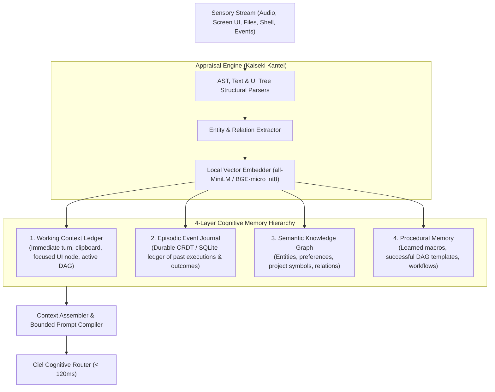
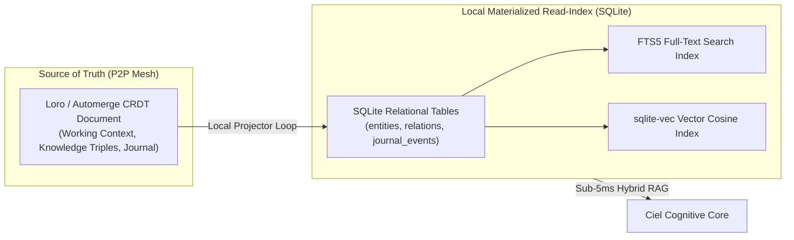
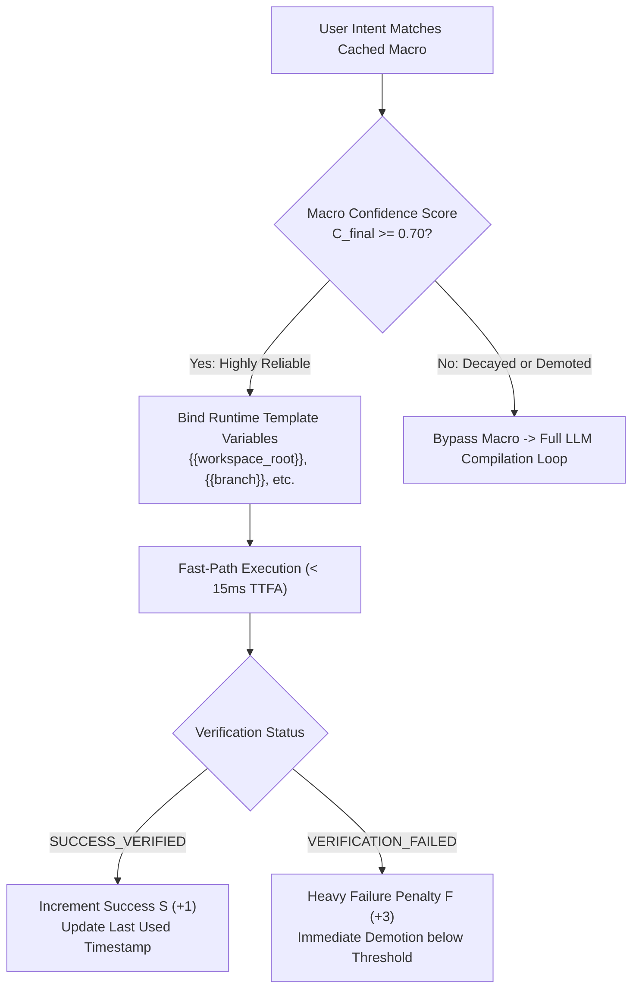

# MEMORY AND APPRAISAL SPECIFICATION

> **Subsystem:** EON Memory & Cognitive Context  
> **Module:** `engine/core-rs/crates/eon-cognition`  
> **Integrates:** CHRONOS Context Ledger & Graph Store + Vector Durable State Store + CRDT Distributed Log

---

## 1. Overview & The Appraisal Mindset

In *That Time I Got Reincarnated as a Slime*, Ciel's **Appraisal and Analysis** (*Kaiseki Kantei*) is what gives her omniscience over Rimuru's internal state, skills, and battlefield context. She doesn't just store random chat logs; she constantly parses, structures, links, and indexes information into an actionable operational model.

In EON, memory is **never implemented as an unbounded text dump of conversation logs**. Instead, EON maintains a **Structured Multi-Layer Cognitive Memory**:



---

## 2. The 4-Layer Memory Architecture & Dual-Storage Model

To satisfy both **P2P lock-free mesh synchronization** and **sub-5ms hybrid RAG search**, EON deploys a **Dual-Storage Architecture**:
1. **Source-of-Truth Replication Log**: Stored as **Loro / Automerge CRDT documents**. When nodes connect over QUIC, CRDT state vectors exchange minimal byte deltas without merge conflicts or database locking.
2. **Local Materialized Read-Projection**: Each node continuously projects CRDT state changes into local **SQLite (with FTS5 and `sqlite-vec`)** tables for instant BM25 and vector queries.



### Layer 1: Working Context Ledger (Short-Term / Transient)
- **Scope**: Current active interaction, past 5 minutes of conversational turns, clipboard text, active Android screen node tree, and running background DAG status.
- **Eviction**: Strict bounds (maximum 4,000 tokens / 16 KB character buffer). Older turns are summarized into Layer 2 and cleared from RAM.
- **In-Memory Speed**: Sub-millisecond direct memory access.

### Layer 2: Episodic Event Journal (Durable History)
- **Scope**: Every user goal, synthesized workflow, executed task outcome, error recovery trace, and verified result.
- **Storage**: Loro CRDT append-only log, locally projected into SQLite (`~/.eon/journal.db` or `/data/data/com.eon/databases/journal.db`).
- **Querying**: Indexed by `timestamp`, `objective_id`, `task_id`, and full-text search (FTS5).
- **Restart Resilience**: Retained across reboots and crashes.

### Layer 3: Semantic Knowledge Graph (Long-Term Entities & Relations)
- **Scope**: Facts about the user, project structures, code dependencies, system capabilities, and persistent facts.
- **CRDT Model**: Graph triples `(Subject, Predicate, Object)` stored in a LWW-Element-Set CRDT, projected into SQLite:
  ```sql
  CREATE TABLE entities (
      entity_id TEXT PRIMARY KEY,
      name TEXT NOT NULL,
      type TEXT NOT NULL,
      properties JSON NOT NULL
  );

  CREATE TABLE relations (
      source_id TEXT NOT NULL,
      predicate TEXT NOT NULL,
      target_id TEXT NOT NULL,
      confidence REAL NOT NULL,
      provenance TEXT NOT NULL,
      created_at INTEGER NOT NULL,
      PRIMARY KEY (source_id, predicate, target_id)
  );
  ```
- **Provenance & Truth**: Every fact records its origin (e.g. `USER_EXPLICIT_STATEMENT`, `PARSED_BUILD_FILE`, `SENSOR_READING`).

### Layer 4: Procedural Memory (Learned Skills & Workflow Macros)
- **Scope**: Reusable execution graphs (DAGs) that have proven successful.
- **Mechanism**:
  - When a user repeats a multi-step task sequence or Ciel identifies a high-frequency optimization, the sequence is compiled into a named **Parameterized Workflow Macro**.
  - Future requests matching this intent bypass runtime LLM planning entirely and execute directly via the cached, verified DAG, dropping latency to **< 15ms**.
  - Macros strictly adhere to the **Procedural Memory Hygiene Protocol** (§6) with dynamic parameter binding and statistical confidence decay.

---

## 3. Mid-Task Context Auto-Compaction

During complex multi-step execution (e.g. running builds, inspecting ASTs, running tests), raw tool outputs quickly exceed the 4,000-token working context limit.

EON implements an **Autonomous In-Flight Context Compactor**:
1. When a task completes, its raw stdout/stderr buffer is committed to Layer 2 Episodic Journal on disk.
2. The compactor extracts a structured **5-line diagnostic digest**:
   - Exit code and execution duration.
   - Exact failing file and line number (if any).
   - Core error signature or assertion mismatch.
   - Input and output artifact hashes.
3. Only this 5-line digest is retained in Layer 1 Working Context, preventing token overflows even during 50-step autonomous sessions.

---

## 4. Local Vector Retrieval (Hybrid RAG)

For semantic similarity lookups across local files, documents, and past conversations:
- **Embedding Model**: `bge-micro-v2` or `all-MiniLM-L6-v2` (quantized int8 ONNX, model size < 25 MB).
- **Inference Time**: < 5ms for 64-token sentence on CPU.
- **Index Engine**: SQLite with `sqlite-vec` extension or deterministic in-memory cosine index.
- **Hybrid Search**: Combines BM25 keyword matching with vector cosine similarity:
  $$\text{Score} = 0.5 \cdot \text{BM25Score} + 0.5 \cdot \text{CosineSimilarity}$$

---

## 5. Context Bounding & Anti-Hallucination Invariants

1. **Strict Context Budgeting**: The Context Assembler never builds an LLM prompt exceeding the model's context window. Memory items are ranked by relevance, recency, and importance, and truncated deterministically.
2. **Honesty on Uncertainty**: If a requested fact cannot be retrieved from memory or local sources, EON returns:
   *"Report: Insufficient data in local context. The target parameter is unknown."*
   EON **never** fabricates a confident answer based on missing context.
3. **User-Controlled Forgetting & Correction**:
   - The user can say *"Forget my calendar preferences"* or *"Correct that: our staging port is 8080, not 8000"*.
   - EON updates or deletes the corresponding graph node immediately and verifies the change in the journal.

---

## 6. Procedural Memory Hygiene & Confidence Decay

To prevent stale or rigid execution graphs from causing recurring failures, `eon-cognition` enforces strict **Procedural Memory Hygiene**:



### 6.1 Parameterized Template Generalization
Macros do not store hardcoded file paths or transient values. During macro consolidation, static strings matching active workspace attributes are abstracted into parameterized templates:
```json
{
  "macro_id": "macro_git_feature_sync",
  "template_parameters": ["workspace_root", "feature_branch", "target_remote"],
  "task_graph": [
    {
      "step_key": "step_fetch",
      "capability": "workspace.git@v1",
      "operation": "fetch",
      "parameters": {
        "repo_path": "{{workspace_root}}",
        "remote": "{{target_remote}}"
      }
    },
    {
      "step_key": "step_rebase",
      "capability": "workspace.git@v1",
      "operation": "rebase",
      "parameters": {
        "repo_path": "{{workspace_root}}",
        "upstream_branch": "{{feature_branch}}"
      }
    }
  ]
}
```

### 6.2 Wilson Score Confidence & Exponential Decay
Every procedural macro maintains execution statistics:
- $S$: Verified successes (`VerificationStatus::SuccessVerified`)
- $F$: Verified failures (`VerificationStatus::VerificationFailed`)
- $t_{\text{last}}$: Monotonic timestamp of last execution

To estimate the true success probability even with low sample counts, EON computes the lower bound of the **Wilson Score Interval** ($z = 1.96$ for 95% confidence):

$$W(S, F) = \frac{\hat{p} + \frac{z^2}{2n} - z \sqrt{\frac{\hat{p}(1-\hat{p}) + \frac{z^2}{4n}}{n}}}{1 + \frac{z^2}{n}}$$

where $n = S + F$ and $\hat{p} = \frac{S}{n}$.

To account for environmental drift (e.g. underlying CLI tools or APIs changing over months), the confidence decays exponentially over time:

$$C_{\text{final}} = W(S, F) \cdot e^{-\lambda (t_{\text{now}} - t_{\text{last}})}$$

where $\lambda = \frac{\ln(2)}{\tau}$ with a half-life of $\tau = 30 \text{ days}$.

### 6.3 Immediate Demotion Protocol
1. **Failure Penalty**: If a macro returns `VerificationFailed`, the failure count is penalized immediately ($F \leftarrow F + 3$), drastically lowering $C_{\text{final}}$.
2. **Threshold Barrier**: If $C_{\text{final}} < 0.70$, the macro is automatically deactivated. Ciel bypasses the cache and invokes the tactical SLM to synthesize a fresh DAG grounded in current reality.
3. **Self-Healing Re-Consolidation**: Once the synthesized DAG passes verification 3 consecutive times, it overwrites the decayed macro with updated parameters.
