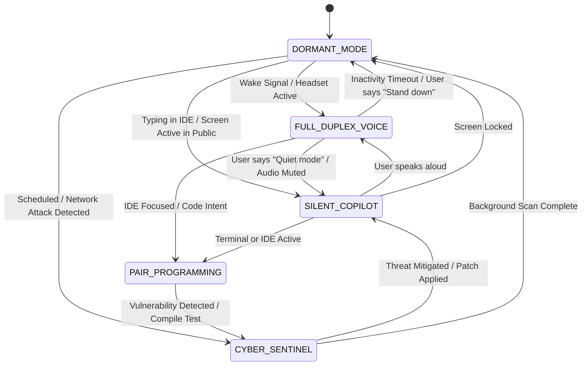
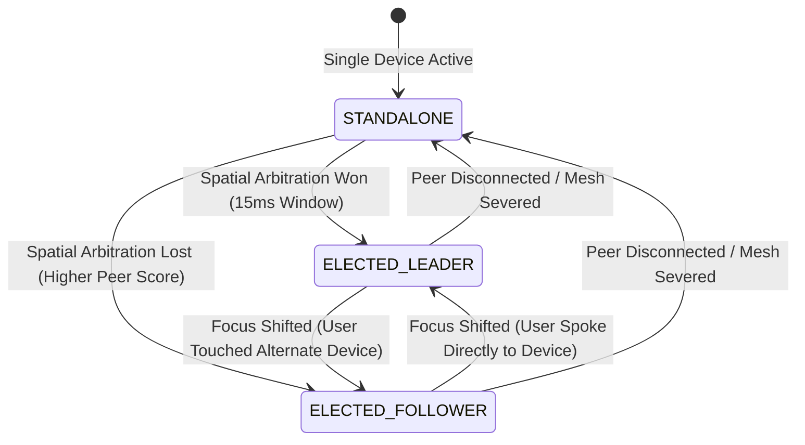

# EON OPERATING MODES & PRESENCE SPECIFICATION

> **Subsystem:** EON Runtime Coordinator  
> **Module:** `engine/core-rs/crates/eon-cognition/src/modes.rs`  
> **Authority:** CANONICAL REFERENCE FOR INTERACTION REGIMES

---

## 1. Executive Summary & Purpose

A personal AI like Ciel must dynamically adapt to the user's physical environment, social context, and task intensity. Running a loud voice speaker while the user is in a quiet meeting, or running heavy AST compilation while on 10% phone battery, violates basic operational integrity.

EON defines **Five Canonical Operating Modes**, each with strict sensory rules, audio policies, compute budgets, and notification thresholds.

---

## 2. The Five Operating Modes

### Mode 1: Full-Duplex Voice Mode (Conversational Companion)
* **Context**: Driving, walking, home, wearing earphones/headset.
* **Sensory Profile**:
  * Microphone: Active continuous streaming (Silero VAD + Zipformer ASR).
  * Speaker: Streaming Neural TTS (Kokoro-82M) enabled with Acoustic Commitment Gate.
  * Barge-In: Active (sub-5ms mute on user interrupt).
* **Cognitive Cadence**: Rapid verbal interaction. TTFA < 170ms. Uses concise voice prefixes (`Affirmative.`, `Report:`).
* **Visuals**: Unobtrusive floating pulse orb on Android overlay; live audio waveform visualizer in CLI.

### Mode 2: Silent Copilot Mode (Whisper / HUD Only)
* **Context**: Quiet environments, library, office, public transit, meetings.
* **Sensory Profile**:
  * Microphone: Dormant or active for sub-vocal whisper only.
  * Speaker: **Muted (Zero Audio Output)**.
* **Output Channel**:
  * Android: Compact floating HUD notification cards and toast pills.
  * Desktop: Non-intrusive system notification or inline terminal text.
* **Behavior**:
  * Observes screen state, clipboard, and notifications silently.
  * Pre-computes relevant links, summaries, and action plans.
  * Displays findings visually without making a sound.

### Mode 3: Autonomous Cyber Sentinel Mode (Defensive Daemon)
* **Context**: Continuous 24/7 background operation, or untrusted network connection (public Wi-Fi).
* **Sensory Profile**:
  * Perception: eBPF syscall monitor, network socket sniffer, file integrity watcher.
  * Voice Engine: Dormant.
* **Compute Budget**: Constrained to 1 CPU core and < 50MB RAM during baseline monitoring; bursts to multi-core during threat analysis.
* **Behavior**:
  * Monitors for unauthorized process spawning, raw socket injection, or binary tampering.
  * Automatically applies live hotpatches and isolates suspicious processes.
  * Only interrupts the user if an unresolvable Tier 4 threat is detected.

### Mode 4: Deep Pair-Programming & Developer Mode (Information Particle Core)
* **Context**: User is actively coding in an IDE (VS Code, Android Studio, Neovim) or working in a terminal.
* **Sensory Profile**:
  * File Watcher: Live AST change monitoring on active git repository.
  * Compiler Bridge: Intercepts build errors from Cargo, Gradle, or Clang.
  * Voice Engine: Ready for spoken directives or silent code generation.
* **Behavior**:
  * Self-healing compiler loop active in shadow sandboxes.
  * Suggests architectural refactors, detects memory leaks, writes unit tests, and verifies fixes before presenting diffs.

### Mode 5: Low-Power Dormant Mode (Battery Preservation)
* **Context**: Device screen locked, battery below 20%, or idle for > 15 minutes.
* **Sensory Profile**:
  * Microphone: Low-power hardware wake-word listening only (or completely off if battery saver is engaged).
  * Inference Engines: Frozen; RAM swapped or pinned to minimal footprint (< 30MB).
  * Mesh Sync: Throttled to fixed 10-minute intervals.
* **Behavior**: Releasing all non-essential resource leases, flushing event journals to disk, preventing background battery drain.

---

## 3. Mode Configuration Matrix

| Mode | Audio In | Audio Out | Screen/Overlay | Mesh Transport | Compute Limit |
|---|---|---|---|---|---|
| **Full-Duplex Voice** | Streaming (16kHz) | Streaming (24kHz) | Floating HUD | P2P QUIC Active | Bursts up to 100% |
| **Silent Copilot** | Whisper / Push-to-Talk | Muted | Cards / Toasts | P2P QUIC Active | Bounded (1-2 Cores) |
| **Cyber Sentinel** | Off | Muted | Security Badge | Background Mesh | Low Background (< 5%) |
| **Pair-Programming** | Optional Voice | Optional Voice | Terminal / IDE Diff | P2P QUIC Active | Multi-Core Compilation |
| **Low-Power Dormant** | Wake-word only | Muted | Off | Periodic Keepalive | < 1% CPU |

---

## 4. Mode Transition Triggers & Voice Commands

1. **Explicit Voice Directives**:
   - *"EON, switch to silent mode"* $\to$ Transitions to `Silent Copilot`.
   - *"EON, stand down"* $\to$ Transitions to `Low-Power Dormant`.
   - *"EON, initiate cyber audit on current network"* $\to$ Transitions to `Cyber Sentinel`.
   - *"EON, help me code this module"* $\to$ Transitions to `Pair-Programming`.
2. **Contextual Triggers**:
   - Headset plugged in / Bluetooth earphone connected $\to$ Prompts or automatically enters `Full-Duplex Voice`.
   - Android battery level drops below 15% $\to$ Automatically degrades to `Low-Power Dormant` with an unobtrusive notice card.
   - Laptop connects to untrusted Wi-Fi $\to$ Engages `Cyber Sentinel` in the background.

---

## 5. Multi-Device Co-Located Presence & Spatial Transition Rules

When multiple EON devices (e.g. an Android phone and a Linux/Windows workstation) are co-located in the same acoustic space, they coordinate their operating modes to maintain a seamless single-mind presence:

### 5.1 Operating Mode Constraints for Co-Located Devices

| Node Status | Audio In (Mic) | Audio Out (Speaker) | Visual Display | Computational Role |
|---|---|---|---|---|
| **Elected I/O Leader** | Active (16kHz stream) | Active (Kokoro Neural TTS) | Primary HUD & Floating Overlay | Handles conversational turn; drives dialogue loop |
| **Co-Located Follower** | Diversity Ear (Active VAD) | **Strictly Muted (0dB)** | Secondary Notification Toast | Background worker; shares screen/clipboard context |
| **Disconnected Node** | Standalone Mic | Standalone Audio | Local Default | Executes local fallback SLM |

### 5.2 Dynamic Handover Rules
1. **Focus Handoff**: If the user is speaking to their desktop while coding (`PAIR_PROGRAMMING` Leader) and subsequently lifts their phone and taps the screen, the phone's next `SensoryClaim` carries `is_screen_unlocked = true` and `last_hid_activity_ms = 0`. The arbitration protocol shifts the I/O Leader role to the phone within 15ms.
2. **Audio Collision Prevention**: Follower nodes do not initialize or stream Kokoro TTS audio buffers to the hardware audio sink. If an in-flight synthesis coroutine was preemptively started, it is immediately cancelled via task abortion.
3. **Power Conservation in Follower State**: Mobile devices acting as followers in the presence of a workstation offload heavy LLM reasoning to the desktop node, keeping phone power consumption under 1.5 Watts.

