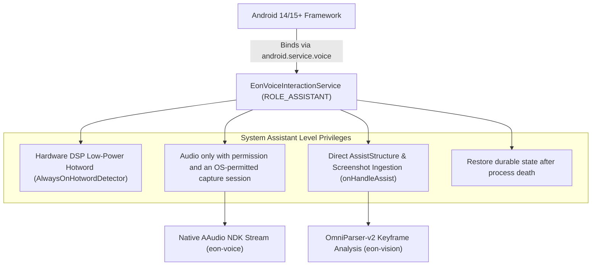

# ANDROID INTEGRATION SPECIFICATION
### Mobile Sensory Presence & Accessibility Bridge

> **Subsystem:** EON Mobile Client  
> **Directory:** `clients/android/`  
> **Platform:** Android 14+ (API 34/35), Min SDK 28  
> **Authority:** CANONICAL BLUEPRINT FOR ANDROID IMPLEMENTATION

---

## 1. Overview & Architectural Role

The Android application (`com.eon.assistant`) serves as EON's mobile eyes, ears, and hands. It connects to the Native Rust Core (`libeon_uniffi.so`) via Mozilla UniFFI and native C/NDK hardware streams.

The Android subsystem provides:
1. **Accessibility Automation**: `EonAccessibilityService` traverses the user-authorized UI tree, finds clickable elements, dispatches gestures, and monitors window state transitions.
2. **Persistent HUD & Thought Visualizer**: `EonOverlayService` renders a non-intrusive floating pulse orb/card over other apps (`TYPE_APPLICATION_OVERLAY`).
3. **Zero-Copy Audio Capture Loop**: `EonCoreService` holds Android's foreground service microphone permission (`FOREGROUND_SERVICE_MICROPHONE`), while the native Rust `eon-voice` engine opens and reads directly from Android's native C/NDK `AAudio` / `Oboe` stream using zero-copy hardware ring buffers. No `sequence<i16>` arrays are copied across JNI during real-time speech.
4. **Multimodal Screen Perception**: Captures screen frames via `MediaProjection` and streams keyframes to `eon-vision` for OmniParser-v2 UI element detection.
5. **Quick Settings Tile**: `EonTileService` allows one-tap toggling of EON between Dormant, Silent Copilot, and Full-Duplex Voice modes.

### Shipped boundary: the private action demo (API 34+)

The inspection shortcut is read-only. Actions are available only in the foreground
`DemoActionActivity`, on its own counter and sample list. To try the fallback on stock
widgets, choose **Try samples without native actions**, then review and confirm a
counter click or list scroll. Changing sample mode clears approval; it does not grant
authority. The confirmation names the route. An advertised native action takes
precedence; once attempted, even a false return or a missing effect **never** causes
a fallback or retry.

The fallback is **activity-local hit testing and UI dispatch**, not an Android input
gesture. A display gesture cannot be bound to the reviewed `View` at delivery. Instead,
the activity derives the unclipped control's center in its own decor at review and
again at confirmation. That point must lie on the known button or a known list row,
with no overlapping sibling on its path. No coordinates are accepted, saved or
exported. The activity calls `performClick()` on that button or `scrollBy()` by at
most one viewport on that list; it never synthesizes touch events, flings, or uses
`AccessibilityService.dispatchGesture`. No manifest permission is needed for this route.

The 15-second, one-use review binds the route, control, starting value, window token,
and inspection-service epoch. Dispatch requires the unlocked, resumed, focused,
full-screen demo, the assistant role, and the enabled service and shortcut. The only
success signal is a counter increase of exactly one or observed forward scroll of
at most one viewport. Native scrolling may animate, so it gets one delayed **read**,
not another dispatch. A canceled or stale review cannot be replayed.

From `engine/android`, build `:app:assembleDebug` and use the existing device gates:

```sh
python3 app/keystore_device_test.py --serial "$CLEAN_AVD" --demo-denied
python3 app/keystore_device_test.py --preconfigured-allowed-serial "$OPERATOR_AVD"
```

Both require explicitly selected, disposable API 34+ emulators. For the allowed
gate, manually install the matching target APK, select EON as assistant, and enable
its accessibility service and shortcut. Leave the device unlocked and the test APK
uninstalled. Neither gate sets roles or enables services. They are separate tests:
passing the clean-device denial gate is not evidence that the allowed gate ran.

On the API 35 Google APIs image, Android reported that EON's assigned accessibility
button was not *shown*. That does not mean the user revoked the shortcut. For this
private demo only, check the exact component in the current user's
`accessibility_button_targets`, the enabled service's button flag and the existing
role, lock and window checks. If Android does not expose the setting, refuse the
action. A change to the assignment invalidates pending review. The shortcut inspector
itself remains read-only.

Lookup starts at the private sample group's `AccessibilityNodeInfo` and matches the
window, package, resource ID and class of each expected child, not its position in
the view list. It does not enumerate other windows. Two fresh API 35 AVDs passed
`demo=PASS-allowed` and `demo=PASS-denied` with the same signed APK: cancel left
the counter at 0, the native click produced 1, the local fallback produced 2, and
both scroll routes advanced the rendered list by at most one viewport.

**Locate sample field** reports only whether the demo's own unsaved `EditText` was
found. It does not expose a value, open an IME, accept edits or grant an action.
The API 35 gate changes the order of the field and its label, then checks that
sensitive, wrong-class and same-ID replacement controls cannot satisfy the lookup.

---

## 2. Android Manifest & Permissions (`AndroidManifest.xml`)

```xml
<?xml version="1.0" encoding="utf-8"?>
<manifest xmlns:android="http://schemas.android.com/apk/res/android"
    package="com.eon.assistant">

    <!-- Audio & Speech -->
    <uses-permission android:name="android.permission.RECORD_AUDIO" />
    <uses-permission android:name="android.permission.MODIFY_AUDIO_SETTINGS" />

    <!-- Overlay & System Interaction -->
    <uses-permission android:name="android.permission.SYSTEM_ALERT_WINDOW" />
    <uses-permission android:name="android.permission.FOREGROUND_SERVICE" />
    <uses-permission android:name="android.permission.FOREGROUND_SERVICE_MICROPHONE" />
    <uses-permission android:name="android.permission.FOREGROUND_SERVICE_CONNECTED_DEVICE" />
    <uses-permission android:name="android.permission.FOREGROUND_SERVICE_MEDIA_PROJECTION" />
    <uses-permission android:name="android.permission.POST_NOTIFICATIONS" />

    <!-- Network & P2P Mesh -->
    <uses-permission android:name="android.permission.INTERNET" />
    <uses-permission android:name="android.permission.ACCESS_NETWORK_STATE" />
    <uses-permission android:name="android.permission.ACCESS_WIFI_STATE" />
    <uses-permission android:name="android.permission.CHANGE_WIFI_MULTICAST_STATE" />
    <uses-permission android:name="android.permission.BLUETOOTH" />
    <uses-permission android:name="android.permission.BLUETOOTH_CONNECT" />

    <!-- Hardware Sensory (Optional) -->
    <uses-permission android:name="android.permission.CAMERA" />
    <uses-permission android:name="android.permission.VIBRATE" />

    <application
        android:name=".EonApplication"
        android:allowBackup="false"
        android:icon="@mipmap/ic_launcher"
        android:label="EON"
        android:roundIcon="@mipmap/ic_launcher_round"
        android:supportsRtl="true"
        android:theme="@style/Theme.Eon">

        <!-- Persistent Core Foreground Service -->
        <service
            android:name=".service.EonCoreService"
            android:exported="false"
            android:foregroundServiceType="microphone|connectedDevice|mediaProjection" />

        <!-- Native Accessibility Controller -->
        <service
            android:name=".accessibility.EonAccessibilityService"
            android:permission="android.permission.BIND_ACCESSIBILITY_SERVICE"
            android:exported="true">
            <intent-filter>
                <action android:name="android.accessibilityservice.AccessibilityService" />
            </intent-filter>
            <meta-data
                android:name="android.accessibilityservice"
                android:resource="@xml/accessibility_service_config" />
        </service>

        <!-- Floating HUD Overlay Service -->
        <service
            android:name=".overlay.EonOverlayService"
            android:exported="false" />

        <!-- Quick Settings Tile -->
        <service
            android:name=".system.EonTileService"
            android:icon="@drawable/ic_eon_tile"
            android:label="EON"
            android:permission="android.permission.BIND_QUICK_SETTINGS_TILE"
            android:exported="true">
            <intent-filter>
                <action android:name="android.service.quicksettings.action.QS_TILE" />
            </intent-filter>
        </service>

        <!-- Native Android Digital Assistant (ROLE_ASSISTANT) -->
        <service
            android:name=".service.EonVoiceInteractionService"
            android:permission="android.permission.BIND_VOICE_INTERACTION"
            android:exported="true">
            <meta-data
                android:name="android.voice_interaction"
                android:resource="@xml/voice_interaction_service_config" />
            <intent-filter>
                <action android:name="android.service.voice.VoiceInteractionService" />
            </intent-filter>
        </service>

        <service
            android:name=".service.EonVoiceInteractionSessionService"
            android:permission="android.permission.BIND_VOICE_INTERACTION"
            android:exported="true" />

    </application>
</manifest>
```

---

## 3. Accessibility Service Configuration (`res/xml/accessibility_service_config.xml`)

```xml
<?xml version="1.0" encoding="utf-8"?>
<accessibility-service xmlns:android="http://schemas.android.com/apk/res/android"
    android:accessibilityEventTypes="typeWindowStateChanged|typeWindowContentChanged|typeViewClicked"
    android:accessibilityFeedbackType="feedbackGeneric"
    android:accessibilityFlags="flagDefault|flagRetrieveInteractiveWindows|flagReportViewIds|flagIncludeNotImportantViews"
    android:canRetrieveWindowContent="true"
    android:canPerformGestures="true"
    android:notificationTimeout="50"
    android:description="@string/accessibility_service_description" />
```

---

## 4. UniFFI Kotlin Integration Pattern & Native Audio

In `EonCoreService.kt`, the Android service initializes the native Rust engine and coordinates system services:

```kotlin
package com.eon.assistant.service

import android.app.Service
import android.content.Intent
import android.os.IBinder
import uniffi.eon_core.*

class EonCoreService : Service() {
    private lateinit var kernelBridge: EonKernelBridge
    private lateinit var voiceBridge: EonVoiceBridge

    override fun onCreate() {
        super.onCreate()
        val storagePath = applicationContext.filesDir.absolutePath
        val identityId = "id_01J9H2X7K9M4N3P2R1Q8S7T6V5"

        // Initialize Rust Native Core
        kernelBridge = EonKernelBridge(storagePath, identityId)
        voiceBridge = EonVoiceBridge()

        // In production, eon-voice attaches directly to native AAudio NDK stream.
        // startListening() commands Rust to open the hardware microphone stream.
        voiceBridge.startListening()

        // Register hardware barge-in callback
        voiceBridge.registerBargeInCallback(object : BargeInCallback {
            override fun onBargeInDetected(timestampMs: Long) {
                // Instantly mute speaker and show listening state on overlay
                EonOverlayService.showListeningState(applicationContext)
            }
        })
    }

    override fun onDestroy() {
        voiceBridge.stopListening()
        super.onDestroy()
    }

    override fun onBind(intent: Intent?): IBinder? = null
}
```

---

## 5. Rich Visual Rendering & Live Artifact Canvas

For interactive code diffs, reverse engineering control-flow graphs, and multimodal bounding box overlays:
- **Android UI Layer**: Authored in **Jetpack Compose Multiplatform + Skia**.
- **Interactive Canvas**: Displays side-by-side AST patches, live video keyframe timelines with scrubbing, and OmniParser annotated element boundaries over the screen.

---

## 6. Android 14/15+ OS Survival & Digital Assistant Role Integration

Modern Android releases (API 34/35) enforce aggressive background restrictions:
1. Third-party apps attempting background microphone recording or screen capture are abruptly killed with `SecurityException` or targeted by OEM battery killers (e.g. Samsung Phantom Process Killer).
2. Background services attempting to launch activities or show overlays face strict foreground initiation barriers.

On stock Android the user may select EON as the **digital assistant (`ROLE_ASSISTANT`)**. The design must respect restrictions even when the role is active:



### 6.1 `EonVoiceInteractionService` Implementation
Declaring a `VoiceInteractionService` makes the app eligible; it does not select the app for the user.
- **Hotword detection**: Check OS support, hardware availability, and enrollment. If unavailable, offer an explicit user-initiated interaction.
- **Microphone**: Require the OS permissions and active capture conditions. Denial or role loss must stop capture, not trigger a fallback recorder.
- **Assist context**: A `VoiceInteractionSession` can receive assist data and a screenshot in separate callbacks. Treat missing data, disabled sharing and protected windows as normal; do not capture around them.
- **Process death**: The OS controls process priority. Restore durable work after restart instead of relying on an OOM score or immunity from process management.

### 6.2 `MediaProjection` Token Lifecycle
For continuous multimodal perception (`eon-vision` 1-5 FPS adaptive sampling):
1. Request user consent via `MediaProjectionManager.createScreenCaptureIntent()` for each session. Never persist or reuse the consent result.
2. Start the user-visible media-projection foreground service with the required permissions and service type before acquiring the projection.
3. Before creating the virtual display, register a [`MediaProjection.Callback`](https://developer.android.com/reference/android/media/projection/MediaProjection). On stop, release the display, surface and readers and stop sending frames to native code. Restoring journaled tasks must not resume a revoked capture.
