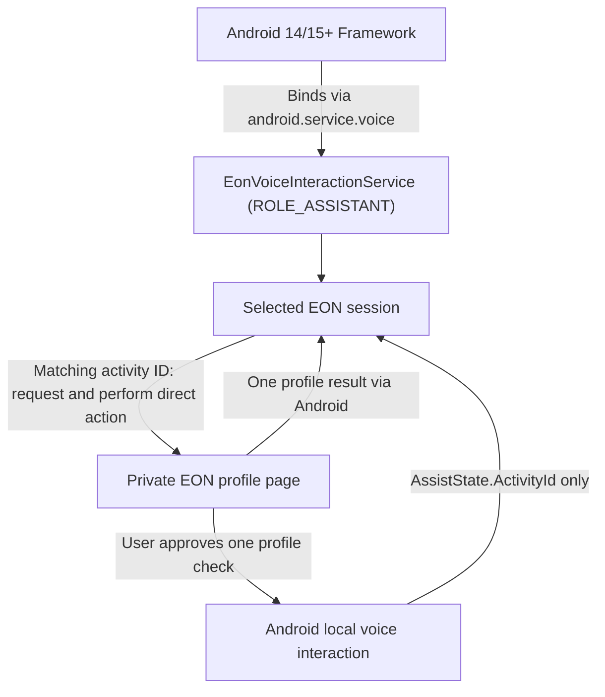

# ANDROID INTEGRATION SPECIFICATION
### Mobile Sensory Presence & Accessibility Bridge

> **Subsystem:** EON Mobile Client  
> **Directory:** `clients/android/`  
> **Platform:** Android 14+ (API 34/35), Min SDK 28  
> **Authority:** CANONICAL BLUEPRINT FOR ANDROID IMPLEMENTATION

---

## 1. Overview & Architectural Role

The Android application (`com.eon.assistant`) serves as EON's mobile eyes, ears, and hands. It connects to the Native Rust Core (`libeon_uniffi.so`) via Mozilla UniFFI and native C/NDK hardware streams.

The Android subsystem provides:
1. **Accessibility Automation**: `EonAccessibilityService` traverses the user-authorized UI tree, finds clickable elements, dispatches gestures, and monitors window state transitions.
2. **Persistent HUD & Thought Visualizer**: `EonOverlayService` renders a non-intrusive floating pulse orb/card over other apps (`TYPE_APPLICATION_OVERLAY`).
3. **Zero-Copy Audio Capture Loop**: `EonCoreService` holds Android's foreground service microphone permission (`FOREGROUND_SERVICE_MICROPHONE`), while the native Rust `eon-voice` engine opens and reads directly from Android's native C/NDK `AAudio` / `Oboe` stream using zero-copy hardware ring buffers. No `sequence<i16>` arrays are copied across JNI during real-time speech.
4. **Multimodal Screen Perception**: Captures screen frames via `MediaProjection` and streams keyframes to `eon-vision` for OmniParser-v2 UI element detection.
5. **Quick Settings Tile**: `EonTileService` allows one-tap toggling of EON between Dormant, Silent Copilot, and Full-Duplex Voice modes.

### Shipped boundary: the private action demo (API 34+)

The inspection shortcut is read-only. Actions are available only in the foreground
`DemoActionActivity`, on its own counter and sample list. To try the fallback on stock
widgets, choose **Try samples without native actions**, then review and confirm a
counter click or list scroll. Changing sample mode clears approval; it does not grant
authority. The confirmation names the route. An advertised native action takes
precedence; once attempted, even a false return or a missing effect **never** causes
a fallback or retry.

The fallback is **activity-local hit testing and UI dispatch**, not an Android input
gesture. A display gesture cannot be bound to the reviewed `View` at delivery. Instead,
the activity derives the unclipped control's center in its own decor at review and
again at confirmation. That point must lie on the known button or a known list row,
with no overlapping sibling on its path. No coordinates are accepted, saved or
exported. The activity calls `performClick()` on that button or `scrollBy()` by at
most one viewport on that list; it never synthesizes touch events, flings, or uses
`AccessibilityService.dispatchGesture`. No manifest permission is needed for this route.

The 15-second, one-use review binds the route, control, starting value, window token,
and inspection-service epoch. Dispatch requires the unlocked, resumed, focused,
full-screen demo, the assistant role, and the enabled service and shortcut. The only
success signal is a counter increase of exactly one or observed forward scroll of
at most one viewport. Native scrolling may animate, so it gets one delayed **read**,
not another dispatch. A canceled or stale review cannot be replayed.

From `engine/android`, build `:app:assembleDebug` and use the existing device gates:

```sh
python3 app/keystore_device_test.py --serial "$CLEAN_AVD" --demo-denied
python3 app/keystore_device_test.py --preconfigured-allowed-serial "$OPERATOR_AVD"
```

Both require explicitly selected, disposable API 34+ emulators. For the allowed
gate, manually install the matching target APK, select EON as assistant, and enable
its accessibility service and shortcut. Leave the device unlocked and the test APK
uninstalled. Neither gate sets roles or enables services. They are separate tests:
passing the clean-device denial gate is not evidence that the allowed gate ran.

On the API 35 Google APIs image, Android reported that EON's assigned accessibility
button was not *shown*. That does not mean the user revoked the shortcut. For this
private demo only, check the exact component in the current user's
`accessibility_button_targets`, the enabled service's button flag and the existing
role, lock and window checks. If Android does not expose the setting, refuse the
action. A change to the assignment invalidates pending review. The shortcut inspector
itself remains read-only.

Lookup starts at the private sample group's `AccessibilityNodeInfo` and matches the
window, package, resource ID and class of each expected child, not its position in
the view list. It does not enumerate other windows. Two fresh API 35 AVDs passed
`demo=PASS-allowed` and `demo=PASS-denied` with the same signed APK: cancel left
the counter at 0, the native click produced 1, the local fallback produced 2, and
both scroll routes advanced the rendered list by at most one viewport.

**Locate sample field** reports only whether the demo's own unsaved `EditText` was
found. It does not expose a value, open an IME, accept edits or grant an action.
The API 35 gate changes the order of the field and its label, then checks that
sensitive, wrong-class and same-ID replacement controls cannot satisfy the lookup.

---

## 2. Android Manifest & Permissions (`AndroidManifest.xml`)

```xml
<?xml version="1.0" encoding="utf-8"?>
<manifest xmlns:android="http://schemas.android.com/apk/res/android"
    package="com.eon.assistant">

    <!-- Audio & Speech -->
    <uses-permission android:name="android.permission.RECORD_AUDIO" />
    <uses-permission android:name="android.permission.MODIFY_AUDIO_SETTINGS" />

    <!-- Overlay & System Interaction -->
    <uses-permission android:name="android.permission.SYSTEM_ALERT_WINDOW" />
    <uses-permission android:name="android.permission.FOREGROUND_SERVICE" />
    <uses-permission android:name="android.permission.FOREGROUND_SERVICE_MICROPHONE" />
    <uses-permission android:name="android.permission.FOREGROUND_SERVICE_CONNECTED_DEVICE" />
    <uses-permission android:name="android.permission.FOREGROUND_SERVICE_MEDIA_PROJECTION" />
    <uses-permission android:name="android.permission.POST_NOTIFICATIONS" />

    <!-- Network & P2P Mesh -->
    <uses-permission android:name="android.permission.INTERNET" />
    <uses-permission android:name="android.permission.ACCESS_NETWORK_STATE" />
    <uses-permission android:name="android.permission.ACCESS_WIFI_STATE" />
    <uses-permission android:name="android.permission.CHANGE_WIFI_MULTICAST_STATE" />
    <uses-permission android:name="android.permission.BLUETOOTH" />
    <uses-permission android:name="android.permission.BLUETOOTH_CONNECT" />

    <!-- Hardware Sensory (Optional) -->
    <uses-permission android:name="android.permission.CAMERA" />
    <uses-permission android:name="android.permission.VIBRATE" />

    <application
        android:name=".EonApplication"
        android:allowBackup="false"
        android:icon="@mipmap/ic_launcher"
        android:label="EON"
        android:roundIcon="@mipmap/ic_launcher_round"
        android:supportsRtl="true"
        android:theme="@style/Theme.Eon">

        <!-- Persistent Core Foreground Service -->
        <service
            android:name=".service.EonCoreService"
            android:exported="false"
            android:foregroundServiceType="microphone|connectedDevice|mediaProjection" />

        <!-- Native Accessibility Controller -->
        <service
            android:name=".accessibility.EonAccessibilityService"
            android:permission="android.permission.BIND_ACCESSIBILITY_SERVICE"
            android:exported="true">
            <intent-filter>
                <action android:name="android.accessibilityservice.AccessibilityService" />
            </intent-filter>
            <meta-data
                android:name="android.accessibilityservice"
                android:resource="@xml/accessibility_service_config" />
        </service>

        <!-- Floating HUD Overlay Service -->
        <service
            android:name=".overlay.EonOverlayService"
            android:exported="false" />

        <!-- Quick Settings Tile -->
        <service
            android:name=".system.EonTileService"
            android:icon="@drawable/ic_eon_tile"
            android:label="EON"
            android:permission="android.permission.BIND_QUICK_SETTINGS_TILE"
            android:exported="true">
            <intent-filter>
                <action android:name="android.service.quicksettings.action.QS_TILE" />
            </intent-filter>
        </service>

        <!-- Native Android Digital Assistant (ROLE_ASSISTANT) -->
        <service
            android:name=".service.EonVoiceInteractionService"
            android:permission="android.permission.BIND_VOICE_INTERACTION"
            android:exported="true">
            <meta-data
                android:name="android.voice_interaction"
                android:resource="@xml/voice_interaction_service_config" />
            <intent-filter>
                <action android:name="android.service.voice.VoiceInteractionService" />
            </intent-filter>
        </service>

        <service
            android:name=".service.EonVoiceInteractionSessionService"
            android:permission="android.permission.BIND_VOICE_INTERACTION"
            android:exported="true" />

    </application>
</manifest>
```

---

## 3. Accessibility Service Configuration (`res/xml/accessibility_service_config.xml`)

```xml
<?xml version="1.0" encoding="utf-8"?>
<accessibility-service xmlns:android="http://schemas.android.com/apk/res/android"
    android:accessibilityEventTypes="typeWindowStateChanged|typeWindowContentChanged|typeViewClicked"
    android:accessibilityFeedbackType="feedbackGeneric"
    android:accessibilityFlags="flagDefault|flagRetrieveInteractiveWindows|flagReportViewIds|flagIncludeNotImportantViews"
    android:canRetrieveWindowContent="true"
    android:canPerformGestures="true"
    android:notificationTimeout="50"
    android:description="@string/accessibility_service_description" />
```

---

## 4. UniFFI Kotlin Integration Pattern & Native Audio

In `EonCoreService.kt`, the Android service initializes the native Rust engine and coordinates system services:

```kotlin
package com.eon.assistant.service

import android.app.Service
import android.content.Intent
import android.os.IBinder
import uniffi.eon_core.*

class EonCoreService : Service() {
    private lateinit var kernelBridge: EonKernelBridge
    private lateinit var voiceBridge: EonVoiceBridge

    override fun onCreate() {
        super.onCreate()
        val storagePath = applicationContext.filesDir.absolutePath
        val identityId = "id_01J9H2X7K9M4N3P2R1Q8S7T6V5"

        // Initialize Rust Native Core
        kernelBridge = EonKernelBridge(storagePath, identityId)
        voiceBridge = EonVoiceBridge()

        // In production, eon-voice attaches directly to native AAudio NDK stream.
        // startListening() commands Rust to open the hardware microphone stream.
        voiceBridge.startListening()

        // Register hardware barge-in callback
        voiceBridge.registerBargeInCallback(object : BargeInCallback {
            override fun onBargeInDetected(timestampMs: Long) {
                // Instantly mute speaker and show listening state on overlay
                EonOverlayService.showListeningState(applicationContext)
            }
        })
    }

    override fun onDestroy() {
        voiceBridge.stopListening()
        super.onDestroy()
    }

    override fun onBind(intent: Intent?): IBinder? = null
}
```

---

## 5. Rich Visual Rendering & Live Artifact Canvas

For interactive code diffs, reverse engineering control-flow graphs, and multimodal bounding box overlays:
- **Android UI Layer**: Authored in **Jetpack Compose Multiplatform + Skia**.
- **Interactive Canvas**: Displays side-by-side AST patches, live video keyframe timelines with scrubbing, and OmniParser annotated element boundaries over the screen.

---

## 6. Android 14/15+ OS Survival & Digital Assistant Role Integration

Modern Android releases (API 34/35) enforce aggressive background restrictions:
1. Third-party apps attempting background microphone recording or screen capture are abruptly killed with `SecurityException` or targeted by OEM battery killers (e.g. Samsung Phantom Process Killer).
2. Background services attempting to launch activities or show overlays face strict foreground initiation barriers.

On stock Android the user may select EON as the **digital assistant (`ROLE_ASSISTANT`)**. The design must respect restrictions even when the role is active:



### 6.1 `EonVoiceInteractionService` Implementation
Declaring a `VoiceInteractionService` makes the app eligible; it does not select the app for the user.
- **Hardware hotword: unsupported by this ordinary app.** The API 35 SDK's `data/api-versions.xml` marks `AlwaysOnHotwordDetector` and its public factory removed in API 31, the first API where EON enables its voice service. The API 35 public `android.jar` exposes neither a detector factory nor a module/enrollment query. In Android 15's [`VoiceInteractionService`](https://android.googlesource.com/platform/frameworks/base/+/android-15.0.0_r1/core/java/android/service/voice/VoiceInteractionService.java) the DSP factory is `@SystemApi`, `listModuleProperties()` is `@TestApi`, and the software detector factory is `@SystemApi` with `MANAGE_HOTWORD_DETECTION`. The assistant role does not change the SDK surface. Availability of a microphone or on-device `SpeechRecognizer` does not establish an enrolled wake word. EON uses the assistant gesture, not a fallback listener. Hardware availability on a particular phone is unknown.
- **Microphone**: Require the OS permissions and active capture conditions. Denial or role loss must stop capture, not trigger a fallback recorder.
- **Assist context**: The binding always disables both structure and screenshot. On Android 15 even an activity-token-scoped show passes through that same binding-wide mask. Filtering an incoming tree by package would be too late. EON does not select an Autofill provider, request an Autofill structure, or send a page to a provider for assistant use.
- **Process death**: The OS controls process priority. Restore durable work after restart instead of relying on an OOM score or immunity from process management.

#### Owner-only direct action (API 35 device check)

With EON selected, open **Review an Android assistant profile check**. Back leaves without checking. **Allow one profile check** starts `Activity.startLocalVoiceInteraction()` from that private page. Only the first showing of a fresh session with the live five-second Binder ticket can proceed. Android scopes the local invocation to its starting activity. The session compares the opaque `AssistState.activityId` with the ID from the source’s `VoiceInteractor.notifyDirectActionsChanged()`; it does not read view data or enumerate visible activities. Only after they match does it call `requestDirectActions`. Android checks the active session and the task’s assist token. EON performs only the fixed `CHECK_MODEL_PROFILE` action; its source rechecks the ticket, policy, selected binding and foreground before reading device memory size. A new showing cannot reuse the result.

**The 9.5 OS-structure gate remains open.** This is OS-supplied assist identity and OS-routed execution, not `AssistStructure` extraction. On API 35, [`startLocalVoiceInteraction`](https://android.googlesource.com/platform/frameworks/base/+/android-15.0.0_r1/services/voiceinteraction/java/com/android/server/voiceinteraction/VoiceInteractionManagerService.java) passes `SHOW_SOURCE_ACTIVITY` without `SHOW_WITH_ASSIST`. [`Activity.showAssist`](https://android.googlesource.com/platform/frameworks/base/+/android-15.0.0_r1/services/core/java/com/android/server/wm/ActivityClientController.java) passes the caller's token, but the system adds both collection flags. [`showSessionLocked`](https://android.googlesource.com/platform/frameworks/base/+/android-15.0.0_r1/services/voiceinteraction/java/com/android/server/voiceinteraction/VoiceInteractionManagerServiceImpl.java) filters by token **and passes the same binding-wide mask**. [`showLocked`](https://android.googlesource.com/platform/frameworks/base/+/android-15.0.0_r1/services/voiceinteraction/java/com/android/server/voiceinteraction/VoiceInteractionSessionConnection.java) therefore forbids both fetches with mask `3`. The public [`AssistStructure()`](https://android.googlesource.com/platform/frameworks/base/+/android-15.0.0_r1/core/java/android/app/assist/AssistStructure.java) is empty; its activity-taking constructor is not public SDK. Neither temporarily relaxing the mask nor constructing a local stand-in meets this gate.

**Owner-context policy.** `getUserDisabledShowContext()` reports the user's two Settings switches, not enterprise policy. Android's [`isAssistDataAllowed`](https://android.googlesource.com/platform/frameworks/base/+/android-15.0.0_r1/services/core/java/com/android/server/wm/ActivityTaskManagerService.java) enforces additional restrictions on OS capture. For its two *app-authored* context routes, EON checks the text switch, the calling user's `DevicePolicyManager.getScreenCaptureDisabled(null)` and, on API 35+, `UserManager.DISALLOW_ASSIST_CONTENT`. On 35+ it also declines non-managed profiles (which can include private space), without querying other users. Missing policy services or failed checks deny sharing. These checks apply before using the context and while showing the result; they are not a substitute for the OS's whole-display policy. The CPU-setting show bundle contains only the one-use Binder ticket, not the reviewed setting.

Use the signed APK and observer installation described below on disposable 3 GiB API 35 Google APIs x86_64 AVDs. Select EON through Settings. Run the allowed case with default policy; for the denied case turn **Use text from screen** off through Android Settings:

```sh
OBS=com.eon.assistant.keystoretest/com.eon.assistant.ProfileActionAcceptance
"$ANDROID_HOME/platform-tools/adb" -s "$SERIAL" shell am instrument -w -r "$OBS"
"$ANDROID_HOME/platform-tools/adb" -s "$SERIAL" shell am instrument -w -r -e policy denied "$OBS"
```

On `AE3A.240806.043/12960925` (enforcing, loopback-only host network, no host audio or cameras), `PASS-os-action` observed the source's completed profile check, `p0_mobile_ultralight`, and a separately confirmed CPU setting. `PASS-policy-denied` observed both refusals and an unexecuted profile check. Both verified a fresh empty assistant card, `mDisabledShowContext=3`, and no microphone use. The observer also accepts `-e policy restricted` or `-e policy capture-disabled` on an already managed test device with just that restriction active. These enterprise denial cases were **not** verified on a managed device: the stock emulator denied the shell permission to impose `no_assist_content`, and the observer refused to count an unrestricted run as a pass. No admin permission was granted. The JVM suite covers denied and unavailable policy inputs.

### 6.2 `MediaProjection` Token Lifecycle
**Implemented on API 35+: grant lifecycle only.** Select EON as the digital assistant in Android Settings, open EON controls, choose **Review a no-output projection grant**, then explicitly open Android's picker. Choose **one app → EON**. The OS owns the scope choice; EON neither queries that scope nor reads anything from it. Assistant selection alone never starts the picker or a grant.

The private singleton controls require EON's live voice binding, the assistant role and an unlocked, interactive device. On return from the picker, the secure controls or the exact EON launcher instance which opened them must have resumed and gained focus. A result expires after 1.5 seconds; both dispatch and consumption check the monotonic deadline. Only an opaque, process-local request ID goes in the service command. The service promotes itself with type `mediaProjection` **before** exchanging the result for a `MediaProjection`, registers its stop callback and retains only the grant. There is **no virtual display, surface, image reader, frame, storage, audio, native bridge, or network output** in this path.

Stop from the grant controls, or use Android's sharing controls if the OS provides them. The diagnostic lease also expires after one minute. Role/binding loss, screen off, task/service teardown and process death invalidate ownership. The service is not sticky. Another session always needs a new foreground tap and picker result. The voice service keeps assist structure and screenshot disabled (`mDisabledShowContext=3`); this is not continuous perception or hotword detection.

#### Reproduce the device checks

Use an empty, offline, setup-complete API 35 `ranchu` AVD, no host audio or cameras, and an explicitly selected `adb -s emulator-N` throughout. In `engine/android`, run `./gradlew :app:test :app:assembleDebug` and `python3 app/keystore_device_test.py --build-only`. Install `app/build/outputs/apk/debug/app-debug.apk` and `app/build/intermediates/keystore-test/keystore-test.apk` with `install -t`. Choose the role through Android Settings, not a shell role or app-op grant. Start EON by its normal launcher entry. Leave accessibility and microphone setup untouched.

1. Run `adb -s emulator-N shell am instrument -w -r com.eon.assistant.keystoretest/com.eon.assistant.ProjectionGrantAcceptance`. The instrumentation targets its **own** package, not the selected voice service. Open the grant controls and obtain the one-app EON grant. If Android foregrounds the selected EON launcher task, reopen the grant controls to expose the `active` checkpoint.
2. Try the system chip's **Stop** if the device exposes it. Alternatively, on the disposable AVD, start `adb -s emulator-N shell am start -n com.eon.assistant.keystoretest/com.eon.assistant.ProjectionReplacementFixture`. Tap the fixture button and approve the **second real Android dialog**. Its typed foreground service holds only the replacement token for three seconds. The observer must see **Android stopped the grant (onStop callback)**, not an app-initiated stop or a timer. Open the picker again and cancel with Back. Expect `PASS-external-stop-denied`.
3. Return to the EON launcher controls. Repeat the instrumentation with `-e phase restart` before the component name. After the real `active` checkpoint, run `adb -s emulator-N shell am force-stop com.eon.assistant`. Relaunch EON, reopen controls and cancel a fresh picker. Expect `PASS-restart-denied`. This checks the previous PID is gone, the new one differs, and both the projection and typed service are gone.

On the tested `system-images;android-35-ext15;google_apis;x86_64` image (`AE3A.240806.046.B2`), the real one-app chooser foregrounded the owned EON launcher. `dumpsys media_projection` reported `(com.eon.assistant, uid=10210): TYPE_SCREEN_CAPTURE` and the service reported `isForeground=true`, type `0x00000020`. External replacement changed the platform owner to the fixture UID, triggered EON's callback, and left `Media Projection: null` and neither service running after release. Both acceptance modes passed. **A tappable status-bar Stop chip was not verified on this image**, including in a discarded null-surface experiment. No flag was changed to enable one; the shipped implementation needs no display.
