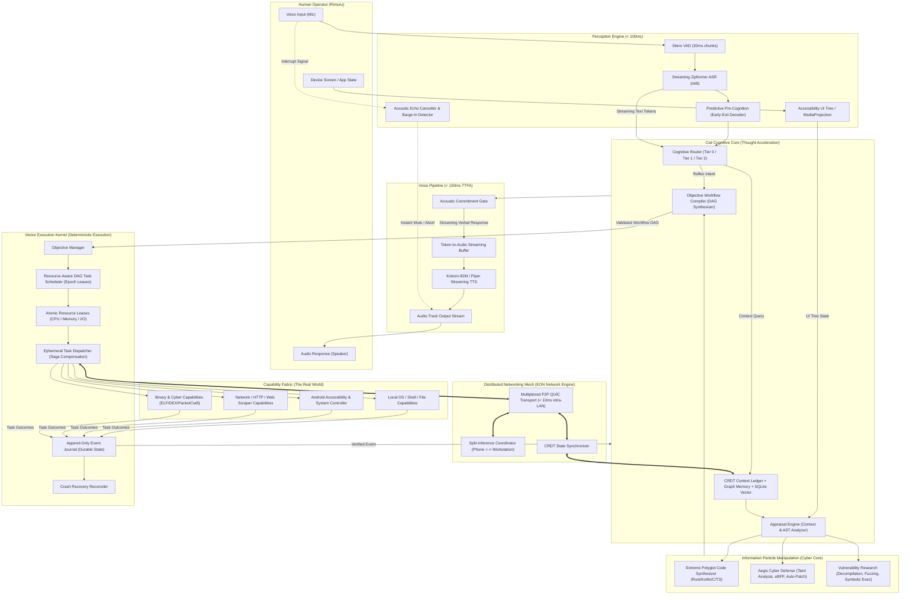
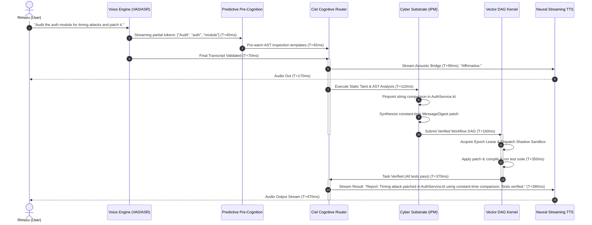

# EON System Architecture Specification

> **Status:** Definitive Architectural Specification  
> **System:** EON (Engine Optimized for Networking & Autonomous Intelligence)  
> **Archetype:** Manas: Ciel (The Sovereign Intelligence, Cyber Core & Distributed Mesh)

---

## 1. Architectural Philosophy: The Ciel Model

EON is designed around four fundamental truths:
1. **Separation of Perception, Cognition, Execution, and Substrate Manipulation**:
   - *Perception* converts analog physical signals (audio, screen pixels, camera frames, network packets) into structured digital events.
   - *Cognition (Ciel)* synthesizes intent, appraises context, formulates goals, and constructs dependency-checked execution graphs (DAGs).
   - *Information Particle Manipulation (Cyber Core)* provides master-level deconstruction, synthesis, and hardening of software code, ASTs, binaries, and network frames.
   - *Execution (Vector Engine)* allocates physical resources (CPU, threads, memory, I/O leases), coordinates workers, executes capabilities, and verifies outcomes against ground truth.
2. **Sub-200ms Latency Budget (Thought Acceleration)**:
   - Voice and reflex loops cannot wait for large multi-gigabyte models or multi-turn cloud handshakes.
   - EON utilizes **Predictive Pre-Cognition** during streaming ASR and a **Tiered Inference Pipeline**:
     - **Tier 0 (Reflex)**: < 20ms deterministic heuristic / local embedding matcher + Acoustic Bridge tokens.
     - **Tier 1 (Tactical)**: < 120ms local quantized SLM (e.g., Gemma-2B int4 / Qwen-2.5-3B) running on-device via ONNX Runtime / NPU.
     - **Tier 2 (Strategic / Mesh)**: Asynchronous high-compute frontier models or workstation-class coding SLMs (Qwen-2.5-32B / Claude 3.5 Sonnet) connected via low-latency QUIC mesh.
3. **Execution Does Not Equal Success**:
   - An API returning `200 OK` or a function returning `void` is **not** proof of completion.
   - EON implements **Temporal State Delta Oracles** (hardware state queries, UI accessibility tree re-inspection, cryptographic hash checks, visual diffs) before reporting completion.
4. **Engine Optimized for Networking (Distributed Cognitive Mesh)**:
   - EON is not confined to one machine. It forms an encrypted, peer-to-peer cognitive mesh spanning mobile edge devices (Android), high-compute workstations, and persistent servers using P2P QUIC and CRDT memory synchronization.

---

## 2. High-Level System Architecture Diagram



---

## 3. End-to-End Latency Budget & Sequence Flow

The benchmark for human conversational comfort is **< 300ms** from end of speech to start of response. EON achieves sub-200ms using **Predictive Pre-Cognition** and **Streaming Clause Synthesis**:

| Stage | Subsystem | Target Latency | P99 Latency | Implementation Technique |
|---|---|---|---|---|
| 1 | VAD (End-of-Utterance) | 30ms | 50ms | Silero VAD (ONNX), 30ms window sliding evaluation |
| 2 | Streaming ASR Token Finalization | 40ms | 80ms | Sherpa-onnx Zipformer int8 streaming decoder |
| 3 | Predictive Pre-Cognition | Concurrently | Concurrently | Evaluates partial tokens *during* speech; pre-warms KV-cache |
| 4 | Cognitive Routing & Acoustic Bridge | 20ms | 40ms | Tier 0 emits acoustic bridge ("Affirmative.") immediately |
| 5 | Token Streaming Generation | 30ms | 60ms | Local quantized SLM (Gemma-2B/Qwen-2.5-3B) with first token in < 30ms |
| 6 | Streaming Neural TTS Synthesis | 40ms | 80ms | Kokoro-82M ONNX chunked synthesis (first 2-3 words) |
| 7 | Audio Driver Output Buffer | 10ms | 20ms | Low-latency audio stream buffer (AAudio / Oboe / WASAPI) |
| **TOTAL** | **Full Speech-to-Audio (TTFA)** | **170ms** | **280ms** | **Exceeds human baseline conversational speed** |

### Execution Sequence Diagram



---

## 4. Repository & Module Directory Layout

The codebase in `d:\Projects\EON — Engine Optimized for Netwotking` is organized across dedicated, decoupled modules:

```text
EON/
├── README.md                              # System Overview, Vision & Ciel Pillars
├── AGENT_EXECUTION_GUIDE.md               # Mandatory Agent Zero-Question Protocol
├── docs/                                  # Definitive Specifications
│   ├── ARCHITECTURE.md                    # This document
│   ├── CIEL_CORE_SPECIFICATION.md         # Cognitive Soul & Thought Acceleration
│   ├── CYBER_AND_PROGRAMMING_MASTERY.md   # Information Particle Manipulation & Cyber
│   ├── DISTRIBUTED_NETWORKING_MESH.md     # Engine Optimized for Networking Spec
│   ├── VOICE_PIPELINE_SPECIFICATION.md    # Low-latency duplex STT/TTS
│   ├── EXECUTION_KERNEL_SPECIFICATION.md  # Vector DAG Execution Kernel
│   ├── CAPABILITY_FABRIC_SPECIFICATION.md # Capability & Tool Runtime
│   ├── MEMORY_AND_APPRAISAL_SPECIFICATION.md # Hybrid memory architecture
│   ├── STATE_MACHINE_AND_INVARIANTS.md    # State machine & safety rules
│   ├── ROADMAP_AND_IMPLEMENTATION_PLAN.md # Phased implementation backlog
│   ├── SYSTEM_PROMPTS_AND_PERSONA.md      # Ciel Prompts & Output Schemas
│   └── decisions/                         # Architectural Decision Records (ADRs)
│
├── engine/                                # Vector Execution Kernel & Cyber (Kotlin / JVM)
│   ├── build.gradle.kts                   # Root Gradle build configuration
│   ├── settings.gradle.kts                # Module declarations
│   ├── kernel-primitives/                 # Level 0: IDs, Time, Errors, Results
│   ├── foundation-services/               # Level 1: Journal, State Store, Identity
│   ├── execution-foundations/             # Level 2: Events, Leases, State Machines
│   ├── resource-management/               # Resource accounting and budgeting
│   ├── execution-engine/                  # Level 3: DAG Scheduler, Dispatcher, Recovery
│   ├── capability-fabric/                 # Level 4: Tool Registry, Sandboxing
│   ├── cyber-core/                        # Information Particle Manipulation & Security
│   ├── mesh-network/                      # P2P QUIC Transport & CRDT Synchronizer
│   ├── ciel-cognition/                    # Level 5: Thought Acceleration & Compiler
│   └── local-capability-providers/        # OS, Files, Shell, Network, Binary tools
│
├── perception/                            # Perception & Speech Pipeline
│   ├── voice-engine/                      # Sherpa-onnx, Zipformer, Kokoro, VAD
│   └── models/                            # Quantized model weights & ONNX graphs
│
├── clients/                               # Interactive Frontends
│   ├── cli/                               # Interactive terminal interface
│   ├── android/                           # Android persistent presence & overlay
│   └── daemon/                            # System background service & IPC
│
└── tests/                                 # Full-System & Integration Test Suites
    ├── latency-benchmarks/                # Sub-200ms TTFA verification
    ├── cyber-security-tests/              # Vulnerability detection & fuzzing tests
    ├── mesh-network-tests/                # Split-inference & CRDT sync tests
    └── crash-recovery-tests/              # Mid-task kill and reconciliation tests
```
