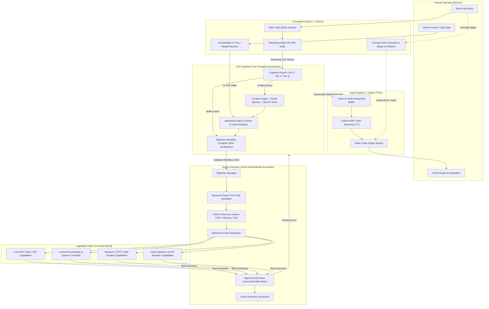
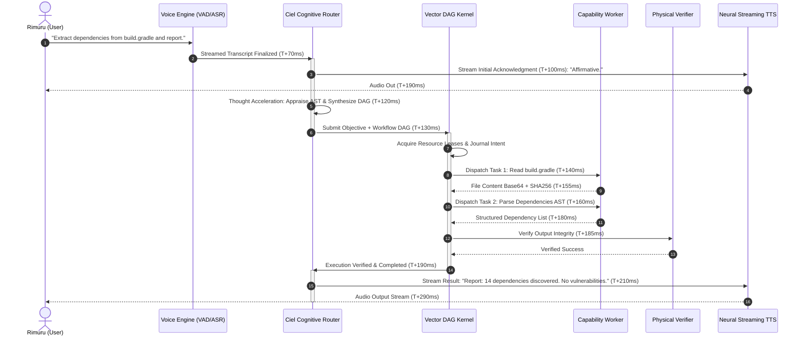

# EON System Architecture Specification

> **Status:** Definitive Architectural Specification  
> **System:** EON (Engine Optimized for Networking & Autonomous Intelligence)  
> **Archetype:** Manas: Ciel (Autonomous Intelligence & Execution Core)

---

## 1. Architectural Philosophy: The Ciel Model

EON is designed around three fundamental truths:
1. **Separation of Perception, Cognition, and Execution**:
   - *Perception* converts analog physical signals (audio, screen pixels, camera frames, network packets) into structured digital events.
   - *Cognition (Ciel)* synthesizes intent, appraises context, formulates goals, and constructs dependency-checked execution graphs (DAGs).
   - *Execution (Vector Engine)* allocates physical resources (CPU, threads, memory, I/O leases), coordinates workers, executes capabilities, and verifies outcomes against ground truth.
2. **Sub-200ms Latency Budget (Thought Acceleration)**:
   - Voice and reflex loops cannot wait for large multi-gigabyte models or multi-turn cloud handshakes.
   - EON utilizes a **Tiered Inference Pipeline**:
     - **Tier 0 (Reflex)**: < 20ms deterministic heuristic / local embedding matcher.
     - **Tier 1 (Tactical)**: < 120ms local quantized SLM (e.g., Gemma-2B int4 / Qwen-2.5-3B) running on-device via ONNX Runtime / NPU.
     - **Tier 2 (Strategic)**: Asynchronous cloud frontier models (Claude 3.5 Sonnet / Gemini 2.0 Flash) for deep background planning and heavy code synthesis.
3. **Execution Does Not Equal Success**:
   - An API returning `200 OK` or a function returning `void` is **not** proof of completion.
   - EON implements **Independent Physical Verification** (hardware state queries, UI accessibility tree re-inspection, cryptographic hash checks) before reporting completion.

---

## 2. High-Level System Architecture Diagram



---

## 3. End-to-End Latency Budget & Sequence Flow

The benchmark for human conversational comfort is **< 300ms** from end of speech to start of response. EON enforces the following strict latency budget:

| Stage | Subsystem | Target Latency | P99 Latency | Implementation Technique |
|---|---|---|---|---|
| 1 | VAD (End-of-Utterance) | 30ms | 50ms | Silero VAD (ONNX), 30ms window sliding evaluation |
| 2 | Streaming ASR Token Finalization | 40ms | 80ms | Sherpa-onnx Zipformer int8 streaming decoder |
| 3 | Cognitive Routing (Tier 0 / 1) | 30ms | 60ms | Local token classification / lightweight embedding lookup |
| 4 | Token Streaming Generation | 30ms | 70ms | Local quantized SLM (Gemma-2B/Qwen-2.5-3B) with first token in < 30ms |
| 5 | Streaming Neural TTS Synthesis | 40ms | 80ms | Kokoro-82M ONNX chunked synthesis (first 2-3 words) |
| 6 | Audio Driver Output Buffer | 10ms | 20ms | Low-latency audio stream buffer (AAudio / Oboe / WASAPI) |
| **TOTAL** | **Full Speech-to-Audio (TTFA)** | **180ms** | **290ms** | **Exceeds human baseline conversational speed** |

### Execution Sequence Diagram



---

## 4. Repository & Module Directory Layout

The codebase is organized in `d:\Projects\EON — Engine Optimized for Netwotking`:

```text
EON/
├── README.md                              # System Overview & Vision
├── AGENT_EXECUTION_GUIDE.md               # Mandatory Agent Execution Protocol
├── docs/                                  # Definitive Specifications
│   ├── ARCHITECTURE.md                    # This document
│   ├── CIEL_CORE_SPECIFICATION.md         # Cognitive Soul & Thought Acceleration
│   ├── VOICE_PIPELINE_SPECIFICATION.md    # Low-latency duplex STT/TTS
│   ├── EXECUTION_KERNEL_SPECIFICATION.md  # Vector DAG Execution Kernel
│   ├── CAPABILITY_FABRIC_SPECIFICATION.md # Capability & Tool Runtime
│   ├── MEMORY_AND_APPRAISAL_SPECIFICATION.md # Hybrid memory architecture
│   ├── STATE_MACHINE_AND_INVARIANTS.md    # State machine & safety rules
│   ├── ROADMAP_AND_IMPLEMENTATION_PLAN.md # Phased implementation backlog
│   └── SYSTEM_PROMPTS_AND_PERSONA.md      # Ciel Prompts & Output Schemas
│
├── engine/                                # Vector Execution Kernel (Kotlin / JVM)
│   ├── build.gradle.kts                   # Root Gradle build configuration
│   ├── settings.gradle.kts                # Module declarations
│   ├── kernel-primitives/                 # Level 0: IDs, Time, Errors, Results
│   ├── foundation-services/               # Level 1: Journal, State Store, Identity
│   ├── execution-foundations/             # Level 2: Events, Leases, State Machines
│   ├── resource-management/               # Resource accounting and budgeting
│   ├── execution-engine/                  # Level 3: DAG Scheduler, Dispatcher, Recovery
│   ├── capability-fabric/                 # Level 4: Tool Registry, Sandboxing
│   ├── ciel-cognition/                    # Level 5: Thought Acceleration & Compiler
│   └── local-capability-providers/        # OS, Files, Shell, Network implementations
│
├── perception/                            # Perception & Speech Pipeline
│   ├── voice-engine/                      # Sherpa-onnx, Zipformer, Kokoro, VAD
│   │   ├── native/                        # C++ / Rust bindings for audio driver
│   │   └── jvm/                           # JNI / Foreign Function wrappers
│   └── models/                            # Quantized model weights & ONNX graphs
│
├── clients/                               # Interactive Frontends
│   ├── cli/                               # Interactive terminal interface
│   ├── android/                           # Android persistent presence & overlay
│   └── daemon/                            # System background service & IPC
│
└── tests/                                 # Full-System & Integration Test Suites
    ├── latency-benchmarks/                # Sub-200ms TTFA verification
    ├── crash-recovery-tests/              # Mid-task kill and reconciliation tests
    └── end-to-end-workflows/              # Multi-step autonomous task suites
```

---

## 5. Subsystem Inter-Process Communication (IPC)

EON separates audio capture, cognitive routing, and capability execution across lightweight threads or dedicated processes for stability.

- **Wire Protocol**: Protocol Buffers v3 (`.proto`) over Unix Domain Sockets (`/tmp/eon.sock`) on Linux/Android and Named Pipes (`\\.\pipe\eon`) on Windows.
- **IPC Invariant**: Zero allocation on audio hot-paths. Audio PCM frames (16kHz, 16-bit mono) are streamed via ring buffers / shared memory.
- **Message Contracts**: Every command is tracked by a globally unique `EonExecutionId` (ULID) for complete end-to-end causal observability.
