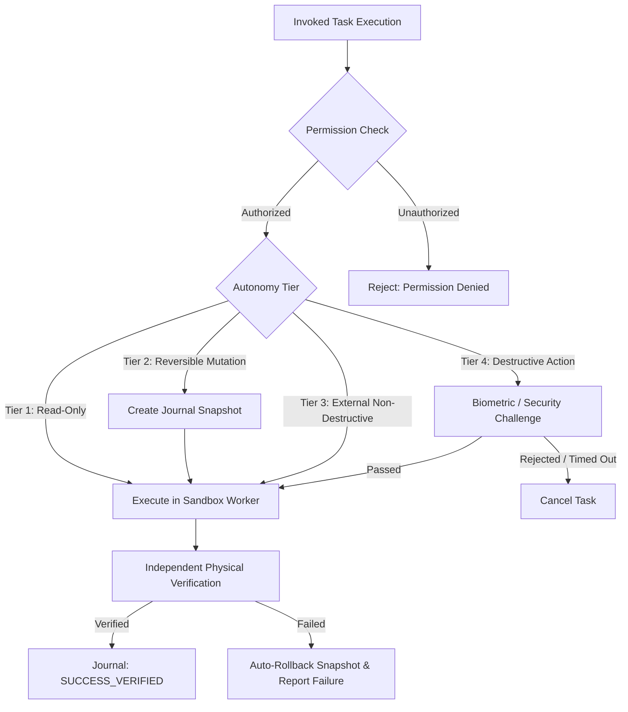

# CAPABILITY FABRIC SPECIFICATION

> **Subsystem:** EON Capability & Tool Runtime  
> **Module:** `engine/capability-fabric`  
> **Integrates:** Vector Governed Tools + CHRONOS Android Accessibility Controllers + Cyber Defense/Offense Core

---

## 1. Overview & Capability Philosophy

The **Capability Fabric** is the operational surface through which EON interacts with the physical device, operating system, applications, file systems, network, and cyber substrates.

In adherence to Vector, CHRONOS, and Ciel principles:
1. **Contract-First**: Every capability declares a strongly-typed schema, semantic version, and explicit input/output structures. No arbitrary `Map<String, Any>` or raw unvalidated strings are passed across capability boundaries.
2. **Bounded Output Principle**: A capability never returns an unbounded memory blob into cognitive context. If reading a 500 MB file, it returns a bounded range, a summary, or a SHA-256 digest + URI pointer.
3. **Execution Sandboxing**: Capabilities execute within bounded workers with CPU/memory limits, timeouts, and cancellation hooks.
4. **Independent Verification Hook**: Every capability contract implements a `verify()` method that inspects ground truth after an operation completes.

---

## 2. Capability Architecture & Interface Contracts

```kotlin
package eon.capability

import eon.primitives.EonResult
import eon.primitives.MonotonicInstant

interface Capability {
    val identifier: CapabilityId         // e.g. "workspace.read@v1"
    val description: String              // Semantic purpose
    val operations: Set<String>          // Supported operations
    val permissions: Set<Permission>     // Required security permissions

    fun execute(
        operation: String,
        parameters: CapabilityParameters
    ): EonResult<CapabilityOutcome>

    fun verify(
        operation: String,
        parameters: CapabilityParameters,
        outcome: CapabilityOutcome
    ): EonResult<VerificationStatus>
}

enum class VerificationStatus {
    SUCCESS_VERIFIED,      // Physically verified against OS / hardware / digest
    EXECUTED_UNVERIFIED,   // Execution returned success, but hardware feedback is absent
    VERIFICATION_FAILED    // Execution reported success, but verification proved failure
}
```

---

## 3. Core Capability Catalogs

EON comes out-of-the-box with eight comprehensive capability domains:

### 3.1 Workspace & Artifact Capabilities (`workspace.*`)
Designed for safe, bounded, high-speed inspection and mutation of local code and documents.
- `workspace.read`: Reads UTF-8 or binary files within bounded line ranges or byte offsets. Returns SHA-256 digest and base64/UTF-8 content.
- `workspace.write`: Performs atomic file writes using temp-file replacement. Verifies file digest on disk immediately.
- `workspace.patch`: Applies unified diffs or exact target-replacement strings. Fails if target string has drifted.
- `workspace.snapshot`: Creates an in-memory or journaled snapshot of a directory before mutations begin.

### 3.2 Process & Development Capabilities (`dev.*` / `process.*`)
Automates developer tasks, builds, and tests deterministically.
- `process.exec`: Spawns local processes with bounded stdout/stderr buffers, timeout kills, and exit code capture.
- `dev.build`: Runs project build tools (`gradlew`, `cargo`, `npm`, `clang`) with automatic failure log extraction.
- `dev.test`: Runs unit or integration tests, parses test XML/reports, and returns pass/fail summaries.
- `dev.ast_inspect`: Parses source code into ASTs (Kotlin, Rust, C/C++, Python, TS) to locate symbols, classes, or function signatures.

### 3.3 Cyber Defense & Hardening Capabilities (`cyber.defense.*`)
Automates host security, static taint tracking, and live patching.
- `cyber.defense.ast_taint`: Traces untrusted user inputs to dangerous execution sinks across source code.
- `cyber.defense.auto_patch`: Generates and applies constant-time cryptographic checks, bounds checks, and sanitized inputs.
- `cyber.defense.ebpf_monitor`: Queries kernel-level syscall telemetry to detect unmapped executable pages or unauthorized privilege escalation.
- `cyber.defense.apk_harden`: Verifies APK signing structures (v2/v3/v4), removes debuggable flags, and secures exported IPC endpoints.

### 3.4 Cyber Offense & Vulnerability Research (`cyber.offense.*`)
Supports reverse engineering, disassembling, and red-team penetration testing in isolated sandboxes.
- `cyber.offense.disassemble`: Disassembles ELF, PE, Mach-O, and DEX binaries into annotated assembly with CFG recovery.
- `cyber.offense.decompile_dex`: Decompiles Android Dalvik bytecode into Smali and Java source trees.
- `cyber.offense.sym_exec`: Runs symbolic execution (Z3 engine) to discover input constraints capable of triggering buffer overflows or logic bypasses.
- `cyber.offense.packet_craft`: Crafts custom raw TCP/UDP/TLS network frames to evaluate protocol robustness and port state.

### 3.5 Distributed Mesh Capabilities (`mesh.*`)
Coordinates tasks across the user's phone, workstation, and server.
- `mesh.rpc_quic`: Dispatches low-latency RPC requests to paired peer nodes over encrypted QUIC streams.
- `mesh.sync_crdt`: Synchronizes working memory, knowledge triples, and task DAG state across devices without locks.
- `mesh.split_inference`: Dynamically offloads compute-heavy SLM or cyber tasks to a high-compute desktop node.

### 3.6 Android System & Accessibility Capabilities (`android.*`)
Inherited and refined from CHRONOS's native accessibility controller:
- `android.screen_inspect`: Dumps active `AccessibilityNodeInfo` hierarchies. Returns visible UI elements, text, and clickable bounds.
- `android.node_click`: Dispatches an accessibility click or gesture to a specific node ID or coordinate fallback.
- `android.input_text`: Enters text into the currently focused accessibility input field.
- `android.system_controller`: Interacts with system bars, media sessions (Spotify, YouTube), volume controls, and notifications.
- `android.overlay`: Controls EON's persistent HUD overlay, audio visualizer, and contextual notification cards.

### 3.7 Network & Web Capabilities (`net.*`)
Enables internet research and data acquisition without cloud model dependencies:
- `net.http_get`: Performs bounded HTTP requests with redirect limits and SSL verification.
- `net.download`: Downloads files directly to local storage with resume support and SHA-256 integrity validation.
- `net.scrape_clean`: Fetches a web page and extracts readable markdown/text using readability algorithms, stripping ads and JS bloat.

### 3.8 Hardware & Device Capabilities (`device.*`)
Direct hardware sensor and actuator control:
- `device.battery`: Queries battery level, thermal status, and charging state.
- `device.flashlight`: Toggles device torch and verifies state via `CameraManager.TorchCallback`.
- `device.camera_capture`: Captures a single frame from CameraX without opening a full camera app.

---

## 4. Capability Sandboxing & Permission Guardrails



### Invariants:
1. **Never Bypass Security Controls**: If an operation touches external accounts or deletes directories, the system halts at Tier 4 for explicit authorization.
2. **Snapshot-Before-Write**: Any write operation on user workspaces or configuration files MUST record a snapshot in the journal before touching the file system.
3. **Auto-Rollback on Failure**: If a multi-step task mutates 3 files and the 4th task fails, the capability manager automatically rolls back the 3 mutated files to their pre-workflow state unless explicit partial retention was requested.
