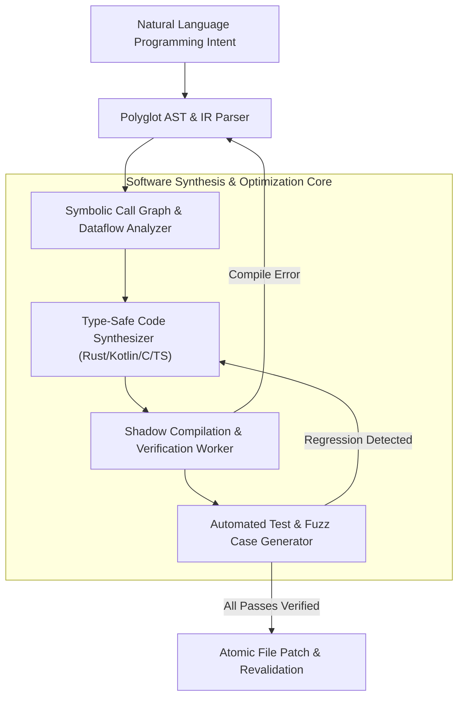
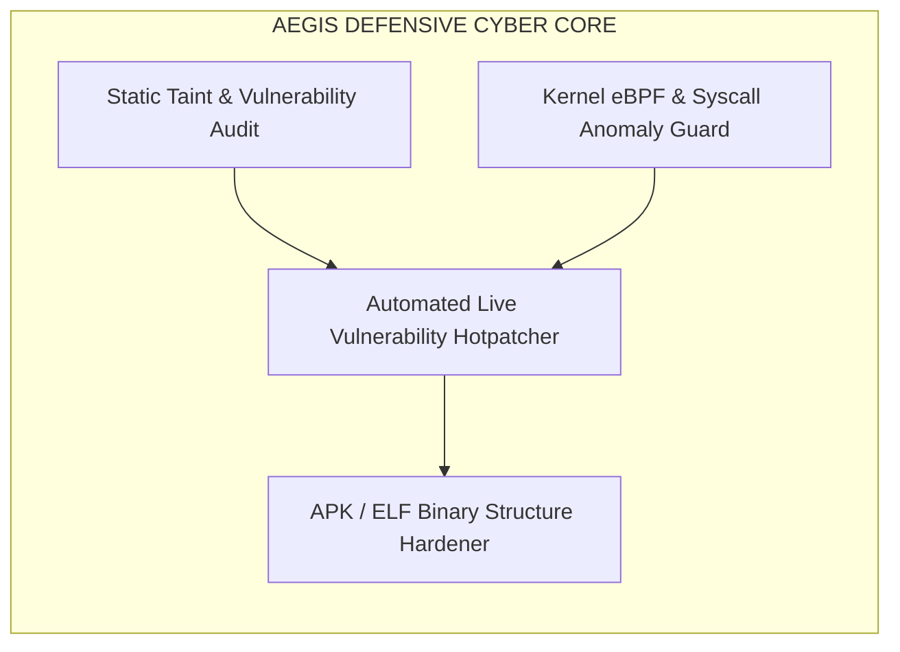
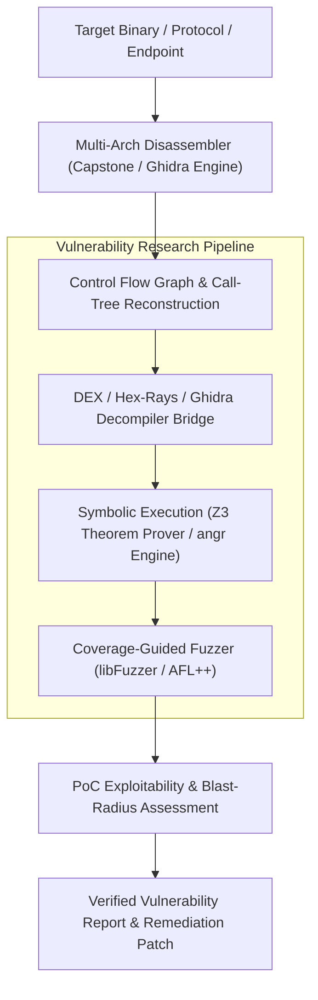

# CYBER AND PROGRAMMING MASTERY SPECIFICATION
### Information Particle Manipulation Subsystem

> **Subsystem:** EON Cyber & Software Engineering Core  
> **Module:** `engine/cyber-core` & `engine/capability-fabric/cyber`  
> **Archetype:** Information Particle Manipulation (*Jōhō Ryūshi Sōsa*)

---

## 1. Overview & Architectural Role

In the Ciel architecture, **Information Particle Manipulation** is the ultimate expression of control over the computational substrate. In EON, software, memory, binaries, and network packets are treated as malleable information structures.

EON is engineered to be an **elite-level programmer and cyber operator**:
1. **Extreme Programming & Autonomous Software Engineering**: Deep understanding of programming language semantics, AST manipulations, compiler optimizations, typing systems, memory safety, and distributed architectures.
2. **Defensive Cyber Operations**: Proactive, automated hardening of host systems, real-time threat detection, kernel-level anomaly monitoring, vulnerability remediation, and cryptographic integrity protection.
3. **Offensive Cyber & Security Research**: In-depth binary reverse engineering, symbolic execution, protocol analysis, automated exploit surface discovery, and red-team penetration simulation within isolated execution sandboxes.

---

## 2. Extreme Programming & Software Synthesis Engine



### 2.1 Supported Languages & Semantic Grammars
- **Systems Languages**: Rust, C, C++20, Go, Zig.
- **JVM / Android**: Kotlin, Java, Dalvik/ART DEX Bytecode, Smali.
- **Web & Scripting**: TypeScript, JavaScript, Python 3.12+, Shell/Bash, PowerShell.
- **Low-Level Machine Representations**: x86_64 and ARM64 assembly, LLVM Intermediate Representation (LLVM IR), WebAssembly (WASM).

### 2.2 The Self-Healing Compiler Loop
When assigned to build or refactor code, EON executes a closed-loop self-correction cycle:
1. **Compilation**: Invokes host toolchains (`cargo`, `gradlew`, `clang`, `tsc`) with structured error capturing.
2. **Diagnostic Parsing**: Extracts exact line numbers, symbol mismatch tables, borrow-checker errors, or missing header files.
3. **AST-Level Remediation**: Rather than guessing string replacements, EON parses the file into an Abstract Syntax Tree, adjusts the specific syntax node, verifies type compatibility, and emits formatted code.
4. **Verification**: Re-runs compilation and test suites until zero warnings and zero test failures remain.

---

## 3. Defensive Cyber Subsystem (The Aegis Core)

The defensive subsystem continuously ensures that host systems, repositories, binaries, and networks remain impenetrable:



### 3.1 Static & Dynamic Taint Analysis
- **Vulnerability Scanner**: Scans code for Common Weakness Enumerations (CWEs):
  - Memory corruption (CWE-119, CWE-416 use-after-free, buffer overflows).
  - Injection flaws (CWE-89 SQLi, CWE-78 command injection).
  - Cryptographic weaknesses (CWE-327 broken crypto, hardcoded secrets, timing attack vulnerabilities).
- **Automated Remediation**: Synthesizes and applies mathematically sound patches (e.g. converting raw pointers to smart pointers/Rust lifetimes, replacing string concatenation with parameterized queries, enforcing constant-time comparisons).

### 3.2 Kernel & Host Hardening (eBPF & Syscall Telemetry)
- Hooks into Linux/Android eBPF or Windows ETW (Event Tracing for Windows) to observe suspicious child process creation, unauthorized raw socket creation, unmapped executable memory allocations (`mprotect(PROT_EXEC)`), and privilege escalation attempts.
- Automatically isolates compromised process trees and notifies the user.

### 3.3 Android APK & Binary Hardening
- Validates APK signature schemes (v1, v2, v3, v4).
- Audits Android Manifests for `exported="true"` activities, broadcast receivers, and content providers without permission guardrails.
- Verifies ELF native library hardening flags: `RELRO` (Relocation Read-Only), Stack Canaries, NX (No-Execute), and ASLR (PIE) compatibility.

---

## 4. Offensive Cyber & Vulnerability Research Subsystem

All offensive capabilities operate under strict governance: they are designed for security research, red-teaming, authorized penetration testing, and software validation.



### 4.1 Binary Disassembly & Reverse Engineering
- Supports ELF (x86_64, ARM, AArch64), PE (Windows), Mach-O (macOS/iOS), and DEX (Android Dalvik).
- Recovers control flow graphs (CFGs), resolves indirect function pointers, reconstructs struct layouts from memory offsets, and decompiles DEX bytecodes into readable Smali and Java source.

### 4.2 Symbolic Execution & Exploit Path Finding
- Integrates SMT/SAT solvers (Z3) to solve constraints along execution branches.
- Determines whether user-controlled input can reach critical program counters (`PC` / `EIP`), corrupt return addresses, or bypass authentication logic without brute forcing.

### 4.3 Network Penetration & Protocol Analysis
- **Raw Packet Crafting**: Builds custom TCP, UDP, ICMP, DNS, and TLS handshake frames.
- **Protocol Fuzzing**: Mutates packet structures to discover state machine crashes or buffer over-reads in network daemons.
- **Isolated Execution**: High-risk exploit simulations run exclusively inside ephemeral, network-isolated containers (Docker / Firecracker microVMs) to prevent host compromise.

---

## 5. Capability Contracts: Cyber & Coding Tools

Below are the strongly-typed capability contracts exposed through the Capability Fabric:

```kotlin
package eon.capability.cyber

import eon.capability.Capability
import eon.primitives.EonResult

/** Inspects AST and control flow for security vulnerabilities. */
interface AstSecurityAuditCapability : Capability {
    fun auditWorkspace(
        workspacePath: String,
        targetLanguages: Set<String>,
        threatThreshold: ThreatSeverity
    ): EonResult<SecurityAuditReport>
}

/** Disassembles and inspects native binaries or Android DEX files. */
interface BinaryInspectionCapability : Capability {
    fun inspectBinary(
        binaryPath: String,
        architecture: TargetArch
    ): EonResult<BinaryAnalysisSummary>

    fun decompileMethod(
        binaryPath: String,
        symbolOrAddress: String
    ): EonResult<DecompiledMethod>
}

/** Synthesizes and verifies code patches across files. */
interface AutonomousPatchCapability : Capability {
    fun synthesizePatch(
        workspacePath: String,
        issueDescription: String,
        failingTestCommand: String
    ): EonResult<PatchApplicationResult>
}
```

---

## 6. Autonomy and Safety Protocols for Cyber Operations

1. **Defensive Operations Are 100% Autonomous**:
   - Patching local vulnerabilities, running AST security audits, updating dependencies, and hardening binary configurations execute immediately without asking for user permission.
2. **Offensive & Penetration Testing Boundaries**:
   - In-memory disassembly, fuzzing local binaries, and AST symbolic execution execute autonomously within local sandboxes.
   - Any external network penetration testing or port scanning against remote IP addresses requires verified domain ownership or an explicit user directive.
   - Generating proof-of-concept exploits is strictly bound to ephemeral, air-gapped test sandboxes.
