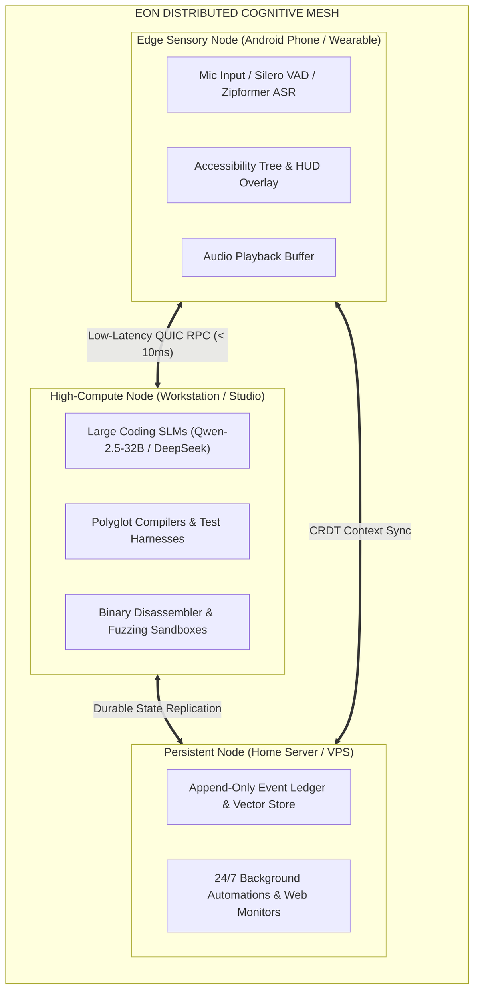
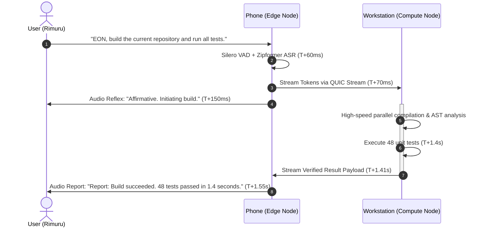

# DISTRIBUTED NETWORKING MESH SPECIFICATION
### Engine Optimized for Networking (EON Core)

> **Subsystem:** EON Networking & Distributed Mesh Engine  
> **Module:** `engine/mesh-network` & `clients/daemon/mesh`  
> **Protocol:** P2P QUIC / Noise Protocol / CRDT State Synchronization

---

## 1. Vision & Architecture: Why "Engine Optimized for Networking"?

EON stands for **Engine Optimized for Networking**. A truly omnipresent, proactive AI companion like Ciel cannot be trapped inside a single isolated device. Ciel must exist wherever the user is—on their Android phone, desktop workstation, home server, or cloud nodes—functioning as a **single, unified, distributed cognitive mesh**.

---

## 2. Ultra-Low Latency Transport & Peer-to-Peer Protocol

### 2.1 Transport Layer: Multiplexed P2P QUIC
- **Underlying Protocol**: QUIC (RFC 9000) over UDP.
- **Benefits**: Zero Head-of-Line blocking, connection migration (survives switching from Wi-Fi to 5G without dropping active audio streams), and sub-millisecond connection resumption (0-RTT).
- **Security & Encryption**: Authenticated via Mutual TLS 1.3 (mTLS) with ed25519 cryptographic identity keys generated at initial setup.
- **Zero-Config Discovery**: Local nodes automatically discover peers using mDNS (Multicast DNS) and Bluetooth Low Energy (BLE) beacons. Remote peers connect via NAT-traversal STUN/TURN relays or wireguard mesh.

### 2.2 Split-Inference & Offloading Engine
To maintain sub-200ms latency while running multi-billion parameter models, EON dynamically offloads work across the mesh:

- **Graceful Offline Fallback**: If the desktop workstation is powered off or network connection is severed, the phone automatically degrades to local on-device quantized models (Gemma-2B / Kokoro-82M) without crashing.

---

## 3. CRDT-Synchronized Cognitive State

EON maintains a unified memory and task state across all devices using **Conflict-free Replicated Data Types (CRDTs)**. No central database lock is required.

### 3.1 Cognitive State CRDT Primitives
1. **Working Context Ledger (LWW-Element-Set CRDT)**:
   - Stores the active conversational state, focused window, and recent observations.
   - Updates use Last-Write-Wins (LWW) based on Lamport logical timestamps.
2. **Semantic Knowledge Graph (Obsidian-Style Graph CRDT)**:
   - Additions of entity nodes and relationship edges are commutative and associative.
   - Simultaneous fact additions on the phone and desktop merge deterministically without merge conflicts.
3. **Task & Execution Journal (PNCounter & ORSet CRDT)**:
   - Distributed task tracking. If a background download finishes on the server while the user is using the phone, the task completion event propagates immediately.

---

## 4. Distributed Capability Execution & Remote Leases

Capabilities registered on any node in the mesh are callable across the network:
- A phone can dispatch a `dev.build` task that executes directly on the desktop's NVMe drive.
- A desktop script can dispatch an `android.notification` or `android.accessibility` action on the phone.

### Distributed Lease Protocol
- **Lease Coordination**: Managed via lightweight Raft consensus or lease tokens with bounded physical wall-clock expiration.
- **Network Partition Resilience**: If a network partition occurs, leases held on disconnected remote nodes expire after 5 seconds, allowing local execution to resume safely.
