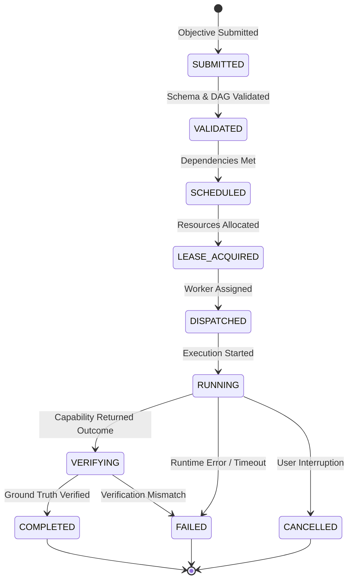
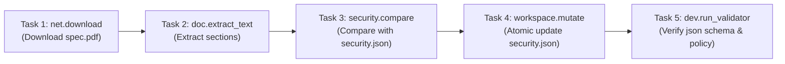

# EXECUTION KERNEL SPECIFICATION (VECTOR CORE)

> **Subsystem:** EON Deterministic Execution Engine  
> **Module:** `engine/execution-engine`  
> **Derived from:** Vector Generation 2 Deterministic Architecture

---

## 1. Core Principles & Separation

In EON, **cognition and execution are strictly decoupled**:
- **Cognition (Ciel)** answers: *What needs to be done?* It synthesizes human intent into a structured **Objective** and a validated **Workflow DAG**.
- **The Execution Kernel (Vector Engine)** answers: *How can this be executed with maximum efficiency, deterministic safety, resource accounting, and crash resilience?*

The Execution Kernel owns scheduling, task dispatch, atomic resource leases, event journaling, state persistence, error isolation, and crash recovery.

---

## 2. Canonical Dependency Levels (0 through 5)

Dependencies flow strictly downward. Lower levels never import or depend on types from higher levels:

```text
Level 5: Advanced Intelligence (Ciel Cognition)
         - ObjectiveWorkflowCompiler, WorkflowSynthesizer, WorkflowOptimizer
         ▲
Level 4: Capability Fabric
         - CapabilityRegistry, ToolProviders, SecuritySandboxes, DynamicPlugins
         ▲
Level 3: Execution Engine
         - DeterministicExecutionEngine, TaskScheduler, TaskDispatcher,
           LocalExecutionRecoveryWorker, ExecutionReconciler
         ▲
Level 2: Execution Foundations
         - ExecutionState, FiniteStateMachine, ResourcePrimitives, Leases, Events
         ▲
Level 1: Foundation Services
         - Identity, Append-Only Event Journal, Durable State Store, Security
         ▲
Level 0: Kernel Primitives
         - Strongly Typed Identifiers (ULID), Monotonic Time, EonResult<T>, EonError
```

---

## 3. Canonical Domain Primitives & Data Contracts

The execution kernel operates on a closed, strongly-typed set of domain primitives:

### 3.1 Objective
An objective represents the high-level intent declared by the user or synthesized by Ciel.
```kotlin
data class Objective(
    val id: ObjectiveId,             // Typed format: "obj_<ULID>"
    val ownerId: IdentityId,         // User or system identity
    val description: String,         // Human intent description
    val priority: Priority,          // CRITICAL, HIGH, NORMAL, BACKGROUND
    val createdAt: MonotonicInstant, // Monotonic timestamp
    val deadline: MonotonicInstant?  // Optional timeout boundary
)
```

### 3.2 Task
A task is an atomic, non-decomposable unit of work targeting a specific capability contract.
```kotlin
data class Task(
    val id: TaskId,                                  // "task_<ULID>"
    val workflowId: WorkflowId,                      // Parent workflow
    val capability: CapabilityRequirement,            // e.g. "workspace.read@v1"
    val operation: String,                           // e.g. "read_range"
    val parameters: TaskParameters,                  // Typed, validated payload
    val dependencies: Set<TaskId>,                   // Upstream dependencies (DAG)
    val resourceRequirements: List<ResourceRequirement>, // CPU, Memory, File Locks
    val timeoutMs: Long                              // Execution timeout
)
```

### 3.3 Workflow (DAG)
A workflow is a validated Directed Acyclic Graph (DAG) composed of tasks.
```kotlin
data class Workflow(
    val id: WorkflowId,              // "wf_<ULID>"
    val objectiveId: ObjectiveId,    // Linked objective
    val tasks: Map<TaskId, Task>,    // Task graph indexed by ID
    val createdAt: MonotonicInstant
) {
    init {
        // Enforce acyclic constraint via topological sort
        requireAcyclic()
    }
}
```

### 3.4 Execution State & Lifecycle
Every task and workflow transitions through deterministic states managed by an explicit Finite State Machine:



---

## 4. Resource Accounting & Atomic Leases

To prevent deadlocks, out-of-memory crashes, or file lock contention during multi-step parallel processing, the execution engine enforces **Atomic Resource Leases**:

```kotlin
data class ResourceRequirement(
    val resourceType: ResourceType, // CPU_CORES, MEMORY_MB, FILE_LOCK, NETWORK_BANDWIDTH
    val resourceId: String,         // e.g. "file:///d:/repo/build.gradle"
    val amount: Long,               // e.g. 512 (MB)
    val mode: AccessMode            // SHARED_READ, EXCLUSIVE_WRITE
)

interface ResourceManager {
    fun acquireLeases(taskId: TaskId, requirements: List<ResourceRequirement>): EonResult<ResourceLease>
    fun releaseLeases(lease: ResourceLease): EonResult<Unit>
}
```

- **Two-Phase Acquisition**: If a task requires 3 resources, all 3 must be acquired atomically. If one is unavailable, all acquired locks are immediately released, preventing circular wait deadlocks.
- **Lease Expiration**: Every lease has a hardware-clock-backed expiration timeout to prevent abandoned locks after unhandled crashes.

---

## 5. Append-Only Event Journal & Crash Recovery

EON provides **100% durable execution guarantees**. No state change occurs without being committed to the journal first:

```text
Task Execution Request
       │
       ▼
[Append Event to Journal on Disk]  ──► (e.g. TaskDispatchedEvent)
       │
       ▼
[Execute Capability Worker]
       │
       ▼
[Append Outcome Event to Disk]     ──► (e.g. TaskCompletedEvent)
```

### Crash Recovery Reconciler (`LocalExecutionRecoveryWorker`)
If the system process is terminated unexpectedly (OS kill, battery death, crash):
1. Upon restart, `LocalExecutionRecoveryWorker` scans the journal from the last confirmed checkpoint.
2. Identifies tasks that were marked `RUNNING` or `DISPATCHED` but never completed.
3. If the task is marked idempotent, the worker re-dispatches it; if non-idempotent, it is marked `UNCERTAIN_FAILURE` and safely rolls back associated file snapshots.
4. All stale resource leases are purged.
5. The high-level workflow state is reconciled before new requests are accepted.

---

## 6. Multi-Step Execution Example: End-to-End Workflow

Consider the user instruction:  
*"Download the latest specification from https://internal.corp/spec.pdf, check if our security policy matches, update security.json, and run the validator."*

The Execution Engine processes this as a **4-Node DAG**:



1. **Task 1** executes with network lease. Verifies HTTP 200 and file digest.
2. **Task 2** reads local PDF, extracts text into structured JSON.
3. **Task 3** runs local SLM comparison against existing policies, producing an atomic patch.
4. **Task 4** acquires exclusive file lock on `security.json`, takes a journal snapshot, applies edit, verifies SHA-256 hash.
5. **Task 5** runs `./gradlew testSecurityPolicy`. Verifies exit code 0.
6. Ciel delivers the final verbal report:  
   *"Report: Security policy updated to version 2.4 based on internal spec. All 12 validation rules verified."*
