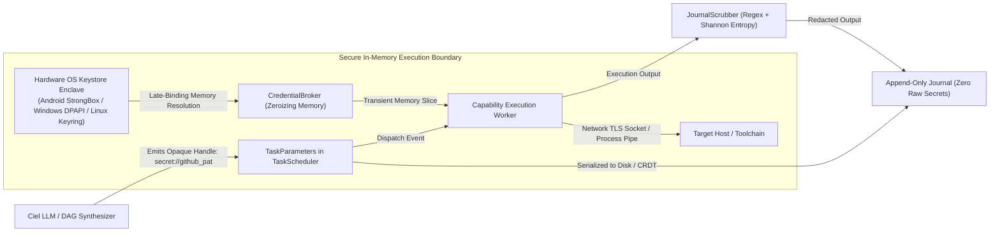

# FOUNDATION AND PRIMITIVES SPECIFICATION

> **Subsystem:** EON Core Foundation & Kernel Primitives  
> **Crates:** `engine/core-rs/crates/eon-primitives` (Level 0) & `engine/core-rs/crates/eon-foundation` (Level 1)  
> **Authority:** CANONICAL BLUEPRINT FOR ERROR TAXONOMY, IDENTIFIERS, JOURNALING & IDENTITY

---

## 1. Overview & Layering

To prevent circular dependencies and guarantee microsecond execution performance, EON enforces strict dependency stratification:

```text
Level 1: Foundation Services (eon-foundation)
         - Append-Only Binary Event Journal
         - Durable State Store (redb / SQLite WAL)
         - Identity & Permission Bitflags
         ▲
Level 0: Kernel Primitives (eon-primitives)
         - Strongly Typed Identifiers (Crockford Base32 ULIDs)
         - Monotonic Time (Nanosecond precision)
         - Result & Error Taxonomy (EonResult, EonError)
```

No crate at Level 0 or Level 1 may depend on higher-level execution, capability, cognition, or networking crates.

---

## 2. Strongly Typed Identifiers (ULIDs)

Identifiers in EON are globally unique, lexicographically sortable, URL-safe, and carry explicit type prefixes to eliminate parameter transposition bugs:

### 2.1 Canonical Prefix Table

| Prefix | Type Name | Crate | Purpose | Example |
|---|---|---|---|---|
| `obj_` | `ObjectiveId` | `eon-primitives` | High-level user or synthesized objective | `obj_01J9H2X7K9M4N3P2R1Q8S7T6V5` |
| `task_` | `TaskId` | `eon-primitives` | Atomic or expandable DAG task node | `task_01J9H2X7K9M4N3P2R1Q8S7T6V6` |
| `wf_` | `WorkflowId` | `eon-primitives` | Directed Acyclic Graph of tasks | `wf_01J9H2X7K9M4N3P2R1Q8S7T6V7` |
| `lease_` | `LeaseId` | `eon-primitives` | Atomic hardware/resource lock reservation | `lease_01J9H2X7K9M4N3P2R1Q8S7T6V8` |
| `id_` | `IdentityId` | `eon-primitives` | User, system, or sub-agent cryptographic identity | `id_01J9H2X7K9M4N3P2R1Q8S7T6V9` |
| `exec_` | `ExecutionId` | `eon-primitives` | Single invocation run trace | `exec_01J9H2X7K9M4N3P2R1Q8S7T6VA` |

### 2.2 Binary & String Encoding
- **Encoding**: 26-character Crockford Base32 (`0123456789ABCDEFGHJKMNPQRSTVWXYZ`, excluding `I`, `L`, `O`, `U` to prevent visual confusion).
- **Structure**:
  - 48 bits: Unix timestamp in milliseconds (gives monotonic chronological sortability until year 10,889 AD).
  - 80 bits: Monotonic counter + entropy (guarantees strict uniqueness even during high-frequency parallel task generation).
- **Validation**:
  ```rust
  let task_id = TaskId::from_str("task_01J9H2X7K9M4N3P2R1Q8S7T6V6")?;
  // Rejects invalid prefixes:
  assert!(TaskId::from_str("obj_01J9H2X7K9M4N3P2R1Q8S7T6V6").is_err());
  ```

---

## 3. The `EonError` Taxonomy & Result Types

All internal operations return `EonResult<T> = Result<T, EonError>`. EON defines a closed, strongly typed error taxonomy:

```rust
#[derive(Debug, Clone, PartialEq, Eq)]
pub enum EonError {
    /// Attempted to deserialize or cast an ID with an unexpected prefix
    InvalidId {
        expected_prefix: &'static str,
        actual: String,
    },
    /// Data contract, schema, or DAG validation failed
    ValidationError(String),
    /// Requested hardware resources (CPU cores, memory MB, disk locks) exceed budget
    ResourceExhausted {
        resource: String,
        requested: u64,
        available: u64,
    },
    /// A held resource lease timed out or expired
    ResourceLeaseTimeout {
        lease_id: String,
    },
    /// Action violates autonomy guardrails, permissions, or invariant policies
    SecurityViolation(String),
    /// Requested capability or tool is not registered on the current node or mesh
    CapabilityNotFound {
        capability_id: String,
    },
    /// Capability worker returned an execution failure
    OperationFailed {
        operation: String,
        reason: String,
    },
    /// Unrecoverable internal panic or substrate fault
    InternalError(String),
}
```

---

## 4. Append-Only Binary Event Journal (`eon-foundation`)

In strict adherence to **Invariant 4 (100% Durable Journaling & Crash Resilience)**, no state mutation occurs without prior commitment to the durable journal on disk.

### 4.1 Binary Journal Frame Layout

```text
 0                   1                   2                   3
 0 1 2 3 4 5 6 7 8 9 0 1 2 3 4 5 6 7 8 9 0 1 2 3 4 5 6 7 8 9 0 1
+-+-+-+-+-+-+-+-+-+-+-+-+-+-+-+-+-+-+-+-+-+-+-+-+-+-+-+-+-+-+-+-+
|                     Magic: 0x454F4E4A ("EONJ")                |
+-+-+-+-+-+-+-+-+-+-+-+-+-+-+-+-+-+-+-+-+-+-+-+-+-+-+-+-+-+-+-+-+
|          Version (u16)        |          Reserved (u16)       |
+-+-+-+-+-+-+-+-+-+-+-+-+-+-+-+-+-+-+-+-+-+-+-+-+-+-+-+-+-+-+-+-+
|                                                               |
+                    Sequence Number (u64)                      +
|                                                               |
+-+-+-+-+-+-+-+-+-+-+-+-+-+-+-+-+-+-+-+-+-+-+-+-+-+-+-+-+-+-+-+-+
|                                                               |
+                  Monotonic Timestamp (u64)                    +
|                                                               |
+-+-+-+-+-+-+-+-+-+-+-+-+-+-+-+-+-+-+-+-+-+-+-+-+-+-+-+-+-+-+-+-+
|                       Payload CRC32 (u32)                     |
+-+-+-+-+-+-+-+-+-+-+-+-+-+-+-+-+-+-+-+-+-+-+-+-+-+-+-+-+-+-+-+-+
|                      Payload Length (u32)                     |
+-+-+-+-+-+-+-+-+-+-+-+-+-+-+-+-+-+-+-+-+-+-+-+-+-+-+-+-+-+-+-+-+
|                                                               |
+                     Binary Payload Bytes                      +
|                 (Protobuf / Bincode Encoded)                  |
|                                                               |
+-+-+-+-+-+-+-+-+-+-+-+-+-+-+-+-+-+-+-+-+-+-+-+-+-+-+-+-+-+-+-+-+
```

### 4.2 Journal Invariants:
1. **Pre-Allocation & Zero Torn Writes**: Frames are flushed with `File::sync_data` prior to invoking external side-effects.
2. **CRC32 Checksumming**: Every frame validates its payload CRC32 on read. Corrupted tail bytes from power failure are automatically truncated to the last valid frame offset during boot reconciliation.
3. **Sequential Replay**: The `LocalExecutionRecoveryWorker` replays frames from checkpoint to reconstruct active workflow state in memory.

---

## 5. Identity & Permission Bitflags (`eon-foundation`)

EON manages granular security authorizations across callers (human operator, system scheduler, sub-agents, remote mesh peers):

```rust
bitflags::bitflags! {
    #[derive(Debug, Clone, Copy, PartialEq, Eq)]
    pub struct Permissions: u32 {
        /// Allows reading workspace files, ASTs, and git history
        const READ_WORKSPACE    = 0b00000001;
        /// Allows mutating workspace files, writing patches, creating commits
        const MUTATE_WORKSPACE  = 0b00000010;
        /// Allows spawning local processes and compiling code
        const EXECUTE_PROCESS   = 0b00000100;
        /// Allows running static security audits, decompilation, and fuzzing
        const CYBER_OPERATIONS  = 0b00001000;
        /// Allows outbound network requests and mesh RPC
        const NETWORK_ACCESS    = 0b00010000;
        /// Allows controlling Android accessibility, gestures, and audio hardware
        const DEVICE_CONTROL    = 0b00100000;
        /// Allows spawning independent sub-agents
        const SPAWN_SUBAGENT    = 0b01000000;
    }
}
```

- **Ephemeral Sub-Agents**: When Ciel spawns an exploratory sub-agent, it receives bounded permissions (e.g. `READ_WORKSPACE | EXECUTE_PROCESS` for running tests, without `DEVICE_CONTROL` or `MUTATE_WORKSPACE`).
- **Remote Mesh Peers**: Unauthenticated or untrusted mesh nodes are restricted strictly to read-only or sandboxed execution scopes.

---

## 6. Zero-Knowledge Credential Broker & Journal Redaction (`eon-foundation`)

EON journals every event, task parameter, and execution trace to disk and synchronizes state across mesh devices via CRDTs. If raw secrets, tokens, or credentials appear in task parameters or command outputs, they will permanently leak to disk, vector embeddings, and LLM context windows. `eon-foundation` eliminates this vulnerability through an **Opaque Handle & Late-Binding Architecture**:



### 6.1 Opaque Secret Handles (`secret://<vault_key>`)
- LLMs, DAG definitions, and state journals **never** handle raw API tokens, SSH keys, passwords, or cloud credentials.
- All credential references use opaque URI handles (e.g. `secret://github_pat`, `secret://aws_access_key`, `secret://id_ed25519`).
- Any attempt by an LLM prompt to echo or print the contents of a `secret://` handle is structurally rejected by the runtime.

### 6.2 OS Keystore Enclave & Hardware Backing
Actual credentials reside in hardware-backed platform keyrings managed by `eon_foundation::CredentialBroker`:
- **Android**: `Android Keystore` backed by hardware TEE / StrongBox Keymaster with AES-GCM-256 authenticated encryption.
- **Windows**: Windows Data Protection API (`DPAPI-NG`) backed by TPM 2.0.
- **Linux**: Linux Secret Service API (via D-Bus / `libsecret`) or kernel keyring subsystem.

### 6.3 Late-Binding Resolution in Memory
1. `TaskParameters` retain `secret://` handles throughout DAG scheduling, dependency resolution, and journal logging.
2. At the exact microsecond of task invocation, the worker invokes `CredentialBroker::resolve(&secret_uri)`.
3. The broker decrypts the secret into a transient heap buffer wrapped in `zeroize::Zeroizing<String>` or `zeroize::Zeroizing<Vec<u8>>`.
4. The credential is injected into the TLS stream, HTTP authorization header, or process pipe. Upon completion, the transient memory is actively overwritten with zeros, leaving no residual traces in memory or crash dumps.

### 6.4 Journal Secret Scrubber & Entropy Defense
Before any stdout, stderr, execution result, or parameter payload is appended to the binary journal (`0x454F4E4A`) or SQLite event log, it passes through `JournalScrubber`:
- **Deterministic Token Matchers**: Scans for known token prefixes and formats (`ghp_[a-zA-Z0-9]{36}`, `github_pat_[a-zA-Z0-9_]{82}`, `sk-[a-zA-Z0-9]{48}`, `AKIA[0-9A-Z]{16}`, and PEM headers `-----BEGIN [A-Z ]*PRIVATE KEY-----`).
- **Shannon Entropy Analysis**: Scans string fragments for high-entropy substrings:
  $$\mathcal{H}(X) = -\sum_{i=1}^{n} P(x_i) \log_2 P(x_i)$$
  Any token with $\mathcal{H}(X) > 4.5$ bits/symbol over a window of $> 20$ alphanumeric characters is treated as a suspected secret.
- **Redaction Policy**: Detected credentials are automatically stripped and replaced with `[REDACTED_SECRET:<hash_prefix>]` prior to journal serialization, CRDT replication, or embedding ingestion.
