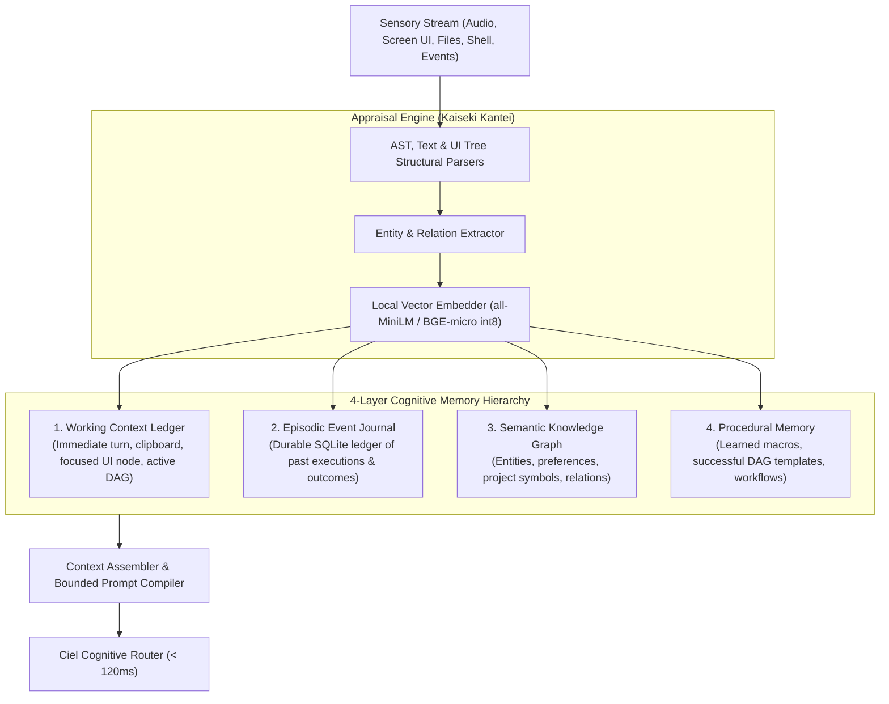

# MEMORY AND APPRAISAL SPECIFICATION

> **Subsystem:** EON Memory & Cognitive Context  
> **Module:** `engine/ciel-cognition/memory`  
> **Integrates:** CHRONOS Context Ledger & Graph Store + Vector Durable State Store

---

## 1. Overview & The Appraisal Mindset

In *That Time I Got Reincarnated as a Slime*, Ciel's **Appraisal and Analysis** (*Kaiseki Kantei*) is what gives her omniscience over Rimuru's internal state, skills, and battlefield context. She doesn't just store random chat logs; she constantly parses, structures, links, and indexes information into an actionable operational model.

In EON, memory is **never implemented as an unbounded text dump of conversation logs**. Instead, EON maintains a **Structured Multi-Layer Cognitive Memory**:



---

## 2. The 4-Layer Memory Architecture

### Layer 1: Working Context Ledger (Short-Term / Transient)
- **Scope**: Current active interaction, past 5 minutes of conversational turns, clipboard text, active Android screen node tree, and running background DAG status.
- **Eviction**: Strict bounds (maximum 4,000 tokens / 16 KB character buffer). Older turns are summarized into Layer 2 and cleared from RAM.
- **In-Memory Speed**: Sub-millisecond direct memory access.

### Layer 2: Episodic Event Journal (Durable History)
- **Scope**: Every user goal, synthesized workflow, executed task outcome, error recovery trace, and verified result.
- **Storage**: Append-only SQLite database (`~/.eon/journal.db` or `/data/data/com.eon/databases/journal.db`).
- **Querying**: Indexed by `timestamp`, `objective_id`, `task_id`, and full-text search (FTS5).
- **Restart Resilience**: Retained across reboots and crashes.

### Layer 3: Semantic Knowledge Graph (Long-Term Entities & Relations)
- **Scope**: Facts about the user, project structures, code dependencies, system capabilities, and persistent facts.
- **Model**: Graph triples `(Subject, Predicate, Object)` stored in SQLite tables:
  ```sql
  CREATE TABLE entities (
      entity_id TEXT PRIMARY KEY,
      name TEXT NOT NULL,
      type TEXT NOT NULL,
      properties JSON NOT NULL
  );

  CREATE TABLE relations (
      source_id TEXT NOT NULL,
      predicate TEXT NOT NULL,
      target_id TEXT NOT NULL,
      confidence REAL NOT NULL,
      provenance TEXT NOT NULL,
      created_at INTEGER NOT NULL,
      PRIMARY KEY (source_id, predicate, target_id)
  );
  ```
- **Provenance & Truth**: Every fact records its origin (e.g. `USER_EXPLICIT_STATEMENT`, `PARSED_BUILD_FILE`, `SENSOR_READING`).

### Layer 4: Procedural Memory (Learned Skills & Workflow Macros)
- **Scope**: Reusable execution graphs (DAGs) that have proven successful.
- **Mechanism**:
  - When a user repeats a multi-step task sequence or Ciel identifies a high-frequency optimization, the sequence is compiled into a named **Workflow Macro**.
  - Future requests matching this intent bypass runtime LLM planning entirely and execute directly via the cached, verified DAG, dropping latency to **< 15ms**.

---

## 3. Local Vector Retrieval (Hybrid RAG)

For semantic similarity lookups across local files, documents, and past conversations:
- **Embedding Model**: `all-MiniLM-L6-v2` or `BGE-micro` (quantized int8 ONNX, model size < 25 MB).
- **Inference Time**: < 5ms for 64-token sentence on CPU.
- **Index Engine**: SQLite with `sqlite-vec` or deterministic in-memory cosine index with HNSW.
- **Hybrid Search**: Combines BM25 keyword matching with vector cosine similarity:
  $$\text{Score} = 0.5 \cdot \text{BM25Score} + 0.5 \cdot \text{CosineSimilarity}$$

---

## 4. Context Bounding & Anti-Hallucination Invariants

1. **Strict Context Budgeting**: The Context Assembler never builds an LLM prompt exceeding the model's context window. Memory items are ranked by relevance, recency, and importance, and truncated deterministically.
2. **Honesty on Uncertainty**: If a requested fact cannot be retrieved from memory or local sources, EON returns:
   *"Report: Insufficient data in local context. The target parameter is unknown."*
   EON **never** fabricates a confident answer based on missing context.
3. **User-Controlled Forgetting & Correction**:
   - The user can say *"Forget my calendar preferences"* or *"Correct that: our staging port is 8080, not 8000"*.
   - EON updates or deletes the corresponding graph node immediately and verifies the change in the journal.
