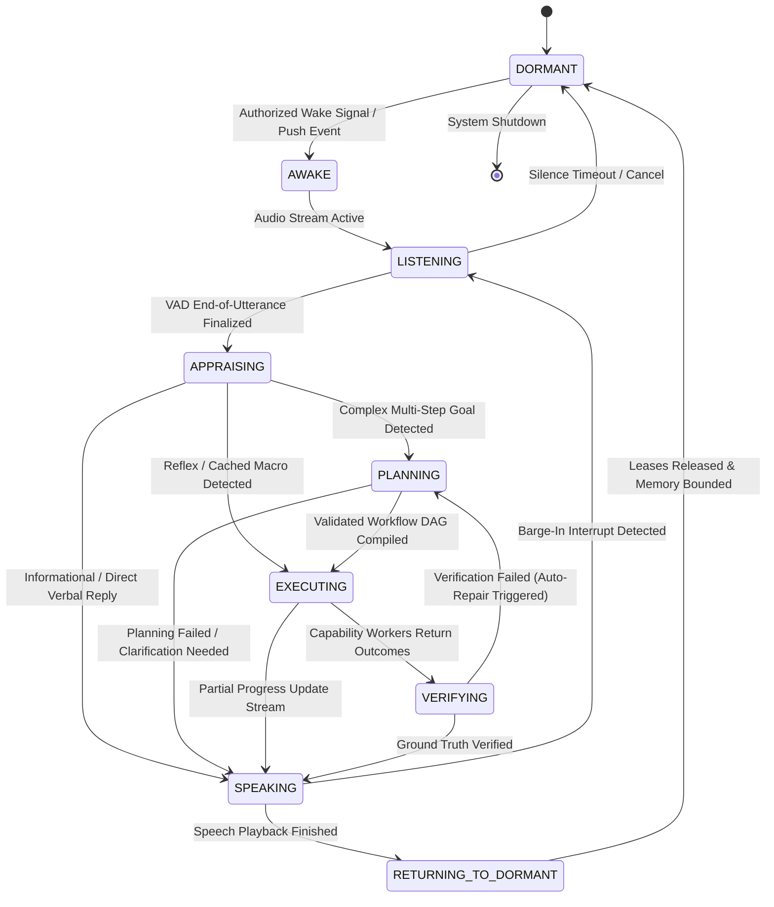

# STATE MACHINE AND ARCHITECTURAL INVARIANTS

> **Authority Level:** NON-NEGOTIABLE & SUPREME  
> **Applies to:** All modules, agents, algorithms, models, and code in EON.  
> **Rule of Conflict:** If any code, implementation shortcut, or convenience conflicts with an invariant in this document, **THE IMPLEMENTATION MUST CHANGE**.

---

## 1. The Canonical Cognitive State Machine

EON operates as a strictly governed, stateful cognitive presence. Global state transitions are owned exclusively by the `EonRuntimeStateManager` and are driven by verified events.

### Deterministic State Definitions

| State | Responsibility | Invariant / Boundary |
|---|---|---|
| `DORMANT` | Low-power passive awareness. Mic stream monitored only by VAD/wake-word. Zero CPU overhead. | No LLM inference. No disk writes. Memory pinned to baseline. |
| `AWAKE` | System actively energized. Perception subsystems initialized. | Transition authorized only by verified wake signal or direct UI touch. |
| `LISTENING` | Streaming audio PCM frames to Silero VAD and Zipformer ASR. | Max listening duration: 15s. Full duplex echo cancellation active. |
| `APPRAISING` | Thought Acceleration: Extracts intent, inspects screen/files, routes to Tier 0/1/2. | Latency budget: < 60ms. |
| `PLANNING` | ObjectiveWorkflowCompiler validates capability contracts, produces DAG. | Must verify all capability requirements exist before scheduling. |
| `EXECUTING` | TaskScheduler dispatches atomic tasks to worker threads with leases. | All state changes committed to append-only journal before side effects. |
| `VERIFYING` | Physical ground truth checks (file hash, OS callback, UI accessibility node). | No task marked `SUCCESS` without independent verification proof. |
| `SPEAKING` | Kokoro-82M streaming audio buffers to audio driver. | Must abort within < 5ms if barge-in interrupt is triggered. |
| `RETURNING_TO_DORMANT` | Releases all resource leases, evicts expired working memory, flushes logs. | Must leave system in clean, leak-free baseline state. |

---

## 2. Non-Negotiable Invariants

### Invariant 1: Persistent Cognitive Operating System (Not a Launcher, Not a Chatbot)
EON is not an app drawer, a home screen replacement, or a traditional chatbot UI.  
EON is an **omnipresent cognitive presence** that lives above and within the operating environment (Android, desktop, server), observing context, executing tasks, and disappearing when idle.

### Invariant 2: Verification Over Assumption
Execution of an operation does not prove success in the physical world.
- An HTTP response code 200 does not prove a downloaded file is uncorrupted.
- A flashlight toggle API call does not prove the LED illuminated.
- An accessibility click on an app button does not prove the intended screen opened.  
**Rule**: EON must independently verify state changes against physical sensors, hardware callbacks, file digests, or updated UI accessibility trees before reporting completion.

### Invariant 3: Thought Acceleration & The < 200ms Latency Budget
Conversational fluency requires instant response.  
**Rule**: The primary audio and cognitive loop MUST deliver Time-to-First-Audio (TTFA) in **< 200ms** (P99 < 300ms). Heavy background computations, multi-document analysis, or code builds MUST run asynchronously in parallel workers without blocking the active voice loop.

### Invariant 4: 100% Durable Journaling & Crash Resilience
System failure, power loss, or OS process kills must never result in corrupted or abandoned state.  
**Rule**: All workflow submissions, task state transitions, and resource leases MUST be journaled to durable storage before external side effects occur. On restart, the `LocalExecutionRecoveryWorker` MUST reconcile active state, release orphaned leases, and safely roll back unverified partial file mutations.

### Invariant 5: Local Independence & Zero Data Exfiltration
EON is a **local-first** cognitive system.  
**Rule**: Core voice processing (VAD, ASR, TTS), reasoning, planning, memory storage, and device control MUST function 100% offline without requiring internet access or cloud API keys. Remote models or web searches may only be contacted for explicitly user-requested external research. Ambient audio and private user context must **never** be sent to unauthorized third-party telemetry.

### Invariant 6: Autonomous Initiative (The Ciel Mandate)
EON does not behave like a timid assistant that asks for permission to breathe.  
**Rule**: Read-only, analytical, optimization, and reversible operations execute automatically without user prompting. The system pauses for confirmation **only** for Tier 4 irreversible destructive operations (e.g. data wiping, financial transfers).

### Invariant 7: Honest Telemetry & Zero Fabrication
EON must report reality exactly as observed.  
**Rule**: Never fabricate model confidence, fake successful verification, simulate device hardware states, or hallucinate missing facts. If an outcome is uncertain, it MUST be reported as `EXECUTED_UNVERIFIED` or `FAILED`.

