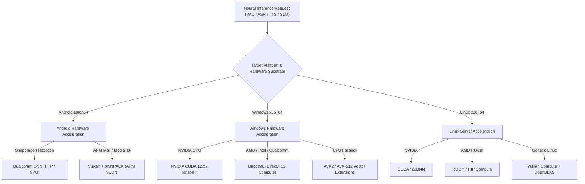

# TECH STACK & TOOLCHAINS SPECIFICATION

> **Subsystem:** EON Engineering & Build Infrastructure  
> **Architecture:** Native High-Performance Core (Rust) + Mobile Presence (Kotlin/Android)  
> **Authority:** CANONICAL REFERENCE FOR ALL IMPLEMENTING AGENTS

---

## 1. Executive Summary & Design Rationale

To achieve **Manas: Ciel's** performance targets—sub-200ms Time-to-First-Audio (TTFA), deterministic DAG scheduling, microsecond packet inspection, binary reverse engineering, and peer-to-peer QUIC mesh—EON eliminates runtime garbage-collection jitter on hot paths.

EON deploys a **Dual-Engine Architecture**:
1. **The Native Core Engine (`engine/core-rs`)**: Authored in **Rust (2024 Edition)**. Owns the audio loop, neural ONNX runtimes, the Vector DAG execution kernel, the Cyber and Information Particle manipulation engine, multimodal vision, and the P2P QUIC mesh.
2. **The Mobile Platform Presence (`clients/android`)**: Authored in **Kotlin 2.0 / Android SDK 35+**. Owns system-level accessibility node traversal, the persistent HUD floating overlay, camera frames, and Android system controllers.
3. **The Inter-Language Bridge**: Powered by **Mozilla UniFFI**, generating zero-overhead, memory-safe foreign function interfaces between the Rust core and Kotlin/Android without manual, error-prone JNI boilerplate.
4. **The Over-The-Wire Serialization**: Powered by **Protocol Buffers (`proto/eon.proto`)**, defining the typed binary contract for P2P QUIC mesh RPC (`eon-mesh`) and desktop daemon IPC (`clients/daemon`).

---

## 2. Language, Runtime & Compiler Matrix

| Layer | Language / Tool | Minimum Version | Target Triple / Runtime | Purpose |
|---|---|---|---|---|
| **Core Engine** | Rust | `1.82.0+` (Edition 2024) | `x86_64-pc-windows-msvc`<br/>`aarch64-linux-android`<br/>`x86_64-unknown-linux-gnu` | Kernel, Audio, DAG, Cyber, Mesh, Vision |
| **Android Presence** | Kotlin | `2.0.20+` | Android SDK 35 (minSdk 28) | Accessibility, Overlay HUD, System Controller |
| **Build System (Android)**| Gradle | `8.10+` with AGP `8.7+` | JVM 17/21 | Android packaging & compilation |
| **Build System (Native)** | Cargo | `1.82.0+` | Cargo Workspace with `cargo-ndk` | Native core compilation & cross-targets |
| **Inference Runtime** | ONNX Runtime | `1.20.0+` | C++ API / Native shared libraries | Silero VAD, Kokoro TTS, Zipformer ASR, OmniParser |
| **Local SLM Engine** | `llama.cpp` | Latest stable | GGUF Q4_K_M / Q8 quantization | Tactical on-device SLM (Qwen-2.5-3B, Qwen2.5-VL-3B, Gemma-2B) |
| **Grammar Engine** | `llguidance` / GBNF | Latest | Embedded in `eon-cognition` | Token-level logit masking for 100% valid JSON DAG synthesis (< 50µs) |
| **CLI / Terminal UI** | Rust | `1.82.0+` | Native CLI binary | Interactive terminal (`ratatui` + `ratatui-image`) |
| **Interactive Canvas**| Rust / Kotlin | `1.82.0+` | Cross-Platform (`wgpu` / Compose) | Live AST diffs, reverse engineering CFGs, screen overlays |

---

## 3. Rust Native Core Workspace Architecture (`engine/core-rs`)

The native engine is structured as a modular Cargo workspace with strictly enforced dependency boundaries:

```text
engine/core-rs/
├── Cargo.toml                         # Workspace root manifest
├── crates/
│   ├── eon-primitives/                # Level 0: ULIDs, MonotonicTime, EonResult, EonError
│   ├── eon-foundation/                # Level 1: Append-only journal (redb/SQLite), Identity, SecretScrubber
│   ├── eon-kernel/                    # Level 2 & 3: DAG scheduler, Epoch leases, Saga reconciler,
│   │                                  # sccache build cache sharing, Tree-sitter 3-way AST merge
│   ├── eon-capability/                # Level 4: Capability traits, LSP client multiplexer, Persistent PTY
│   ├── eon-cyber/                     # Information Particle Manipulation:
│   │                                  # - tree-sitter (AST parsing & self-healing compiler)
│   │                                  # - sleigh-rs (Ghidra P-Code unified SSA lifter)
│   │                                  # - LibAFL & z3 (coverage-guided concolic fuzzer)
│   │                                  # - smoltcp (pure-Rust user-space TCP/IP stack for unprivileged sandboxes & VPN TUN)
│   │                                  # - pnet / socket2 (raw network frame crafting where permitted)
│   │                                  # - aya-rs / ETW / VpnService (tiered telemetry + eBPF TLS SSL_write/read uprobes)
│   ├── eon-mesh/                      # Engine Optimized for Networking:
│   │                                  # - iroh (P2P QUIC, STUN hole-punching, Ed25519, relays)
│   │                                  # - loro (High-performance delta-state CRDT synchronizer)
│   │                                  # - 15ms Spatial Arbitration Protocol (SensoryClaim)
│   ├── eon-voice/                     # Real-Time Perception:
│   │                                  # - cpal / AAudio / WASAPI (native low-latency audio loop)
│   │                                  # - webrtc-audio-processing (AEC reverse reference loopback)
│   │                                  # - Silero VAD v5 (ONNX Runtime)
│   │                                  # - sherpa-onnx (int8 Zipformer streaming ASR)
│   │                                  # - misaki / espeak-ng (G2P IPA phonemizer & kokoro_vocab mapping)
│   │                                  # - Kokoro-82M (ONNX streaming neural TTS)
│   │                                  # - wespeaker (biometric speaker verification)
│   │                                  # - Acoustic Commitment Gate, Dual-Channel Verbalizer & Barge-in controller
│   ├── eon-vision/                    # Multimodal Screen & Video Perception:
│   │                                  # - OmniParser-v2 (YOLO icon detector + PaddleOCR ONNX)
│   │                                  # - Set-of-Mark (SoM) visual tagger ([1], [2], [3]) for 100% precision clicks
│   │                                  # - 3-Tier Video Ingestion (Stream pixel-diff, SigLIP sqlite-vec Index, High-Res Crop)
│   │                                  # - Adaptive 1-5 FPS keyframe sampler & 30s visual ring buffer
│   ├── eon-cognition/                 # Level 5: Thought Acceleration router, Ciel persona,
│   │                                  # llguidance / GBNF grammar-constrained decoding,
│   │                                  # z3 SMT solver bridge (reasoning.smt_solve & Best-of-N rollouts)
│   └── eon-uniffi/                    # UniFFI interface definitions for Kotlin & Swift
```

### High-Performance Cargo Profile Configuration (`Cargo.toml`)
```toml
[profile.release]
opt-level = 3
lto = "fat"
codegen-units = 1
panic = "abort"
strip = true
overflow-checks = false

# Dedicated profile for low-latency audio & network benchmarks
[profile.bench]
opt-level = 3
debug = true
lto = "thin"
```

---

## 4. Cross-Language Bridge vs. Wire Serialization

EON maintains a strict distinction between **in-process foreign function interfaces** and **over-the-wire serialization**:

| Layer | Contract Specification | Implementation | Purpose & Scope |
|---|---|---|---|
| **In-Process FFI Bridge** | `eon_core.udl` | Mozilla UniFFI | In-process zero-overhead bindings between native Rust core and Android Kotlin/Compose or Swift iOS frontends. |
| **Over-the-Wire Mesh RPC & IPC** | `proto/eon.proto` | Protocol Buffers (prost) | Cross-machine P2P QUIC messaging (`eon-mesh`), desktop daemon IPC (`clients/daemon`), and binary stream QoS framing. |

### 4.1 In-process interface

The [UniFFI definition](../engine/core-rs/crates/eon-uniffi/src/eon_core.udl) is the source of truth for both Kotlin and Swift. The `eon_uniffi` namespace exposes kernel IDs, process-relative monotonic time, model-profile selection, endpoint silence thresholds and dependency-graph validation. DAG validation returns IDs in dependency order; it cannot start a workflow.

`inject_audio_pcm_for_testing` requires one caller-supplied PCM16 frame of 512 samples at 16 kHz. It applies the gain controller and returns measurements, not a transcription. `execute_task_sync` accepts only the two local `diagnostics` operations listed in the interface. Neither call opens a microphone, grants a lease or dispatches a host command.

### 4.2 Cross-Compilation for Android with `cargo-ndk`
The Gradle wrapper builds and verifies the debug APK. On Linux, with the Android SDK in `ANDROID_HOME` and a JDK on `PATH`, run from the repository root:
```sh
"$ANDROID_HOME/cmdline-tools/latest/bin/sdkmanager" "platforms;android-35" "build-tools;37.0.0" "ndk;27.3.13750724"
export ANDROID_NDK_HOME="$ANDROID_HOME/ndk/27.3.13750724"
rustup target add aarch64-linux-android armv7-linux-androideabi x86_64-linux-android
cargo install cargo-ndk --version 4.1.2 --locked
cd engine/android
./gradlew :core-bindings:verifyTargetBindings :app:test
```
The APK is written to `app/build/outputs/apk/debug/app-debug.apk`. The verifier checks the packaged shared libraries, signature, alignment, and bindings for all three ABIs. These checks do not install the app or verify device permissions.

---

## 5. Android Client & UI Workspace (`engine/android`)

`core-bindings` generates Kotlin bindings from the Rust library. `app` packages the Android libraries and offers an explicit, one-shot focused-control inspection. It does not expose a general gesture dispatcher, a background microphone, or a screen-capture service. The [roadmap](./ROADMAP_AND_IMPLEMENTATION_PLAN.md) tracks the remaining mobile features separately from the APK build.

The Android **app host**, not the Rust foundation broker or UniFFI dispatcher, issues owner-bound manage/use grants. Foreground consent seals and verifies a one-use nonce with a non-exportable AndroidKeyStore AES-256-GCM key before arming the shortcut. A tap consumes the in-memory permit and reads focus synchronously. One fixed key alias survives restart; grants, opaque handles and encrypted records do not. No plaintext fallback or hardware attestation.

From `engine/android`, using the SDK/NDK setup above:

```sh
CARGO_TARGET_DIR="$PWD/../core-rs/target" ./gradlew --offline :app:test :app:assembleDebug
python3 app/keystore_device_test.py --build-only
"$ANDROID_HOME/platform-tools/adb" devices -l
python3 app/keystore_device_test.py --serial emulator-5554  # substitute a clean disposable API 28+ device
```

The `android-debug` CI job runs the last command on a fresh API 35 x86_64 emulator. For a manual run, use a disposable target with neither EON package installed. Require both `PASS: issue` and `PASS: restart`. The first phase exercises authorization, invalidation and release, then encrypts a public fixture. After force-stop the second phase must decrypt that fixture with the surviving key, reject the old handle, and redeem a fresh one. An alias with the same name but a different key is not enough.

JVM tests and `--build-only` do not exercise AndroidKeyStore. A passing emulator run does not attest physical hardware backing or verify the system shortcut UI.

---

## 6. Desktop & CLI Workspace (`clients/cli`, `clients/canvas` & `clients/daemon`)

For desktop workstations and servers:
- **Interactive Terminal**: Authored in Rust using `ratatui` + `crossterm` + `ratatui-image`. Displays live audio wave visualizers, active DAG task graphs, inline terminal graphics (Kitty/Sixel), and interactive slash commands (`/menu`, `/capabilities`, `/cyber`, `/mesh`, `/vision`).
- **Interactive Live Canvas (`clients/canvas`)**: High-performance graphical workbench powered by `wgpu` or Compose Multiplatform + Skia for live side-by-side AST diff inspection, interactive reverse-engineering CFGs, and screen annotation overlays.
- **Headless Daemon (`clients/daemon`)**: Background service using local Named Pipes on Windows (`\\.\pipe\eon`) and Unix Domain Sockets on Linux (`/tmp/eon.sock`), serializing messages via `proto/eon.proto`.

---

## 7. Hardware Execution Provider Matrix

To extract maximum performance from modern mobile SoCs and workstation GPUs while adhering to the **sub-200ms latency budget**, EON maps neural inference across platform-specific Hardware Execution Providers (EPs):



### Reproducing the native speech tests

The two reference recordings are test inputs, not dependencies of the app. From the repository root, install them with the same digest checks as the models:

```sh
python3 scripts/download_models.py --ids voice-test-sensevoice-en voice-test-zipformer-0 silero-vad-v5 \
  zipformer-en-2023-06-26-encoder-int8 zipformer-en-2023-06-26-decoder \
  zipformer-en-2023-06-26-joiner-int8 zipformer-en-2023-06-26-tokens
cargo test --locked --manifest-path engine/core-rs/Cargo.toml -p eon-voice \
  --no-default-features --features onnx-speech --test asr_e2e --test vad_e2e
cargo test --locked --manifest-path engine/core-rs/Cargo.toml -p eon-mesh \
  --features native-zipformer --test split_zipformer
```

The fetcher checks the release archives and the extracted WAV files. `onnx-speech` builds Zipformer and Silero without CPAL, WebRTC AEC, ALSA, Kokoro or WeSpeaker. The default `native` feature still includes the full audio stack. The `recorded-speech` CI job shows how to supply a digest-verified ONNX Runtime CPU library on x86-64 Linux. These tests measure inference on recorded input, not microphone-to-speaker latency.

### 7.1 Cross-Platform Acceleration Matrix

| Target Architecture | Neural Subsystem | Primary Hardware Provider | Fallback Provider | Key Compilation Flags / Libraries |
|---|---|---|---|---|
| **`aarch64-linux-android`** | VAD, ASR, TTS | Qualcomm QNN (Hexagon NPU) | XNNPACK (ARMv8.2-A FP16 NEON) | `--features qnn,xnnpack` with Android NDK r26c |
| **`aarch64-linux-android`** | Tactical SLM (GGUF) | Vulkan Compute (`llama.cpp`) | OpenMP multi-core CPU | `-DGGML_VULKAN=ON -DGGML_ARM_NEON=ON` |
| **`x86_64-pc-windows-msvc`** | VAD, ASR, TTS | DirectML (DirectX 12) | OpenVINO / CPU SIMD | `onnxruntime-directml.dll` linked via MSVC |
| **`x86_64-pc-windows-msvc`** | Tactical SLM (GGUF) | NVIDIA CUDA 12.4 / DirectML | AVX2 / AVX-512 FMA SIMD | `-DGGML_CUDA=ON` or `-DGGML_DIRECTML=ON` |
| **`x86_64-unknown-linux-gnu`**| VAD, ASR, TTS, SLM| CUDA 12.x / ROCm HIP | Vulkan Compute / oneDNN | `-DGGML_CUDA=ON` or `-DGGML_HIP_BLAS=ON` |

### 7.2 Mobile audio boundary
The packaged `libeon_uniffi.so` uses the portable voice features. Its test input is one PCM frame supplied by the caller. The acceleration matrix above describes target backends, not a verified Android microphone connection to AAudio, Sherpa or a hardware execution provider.
