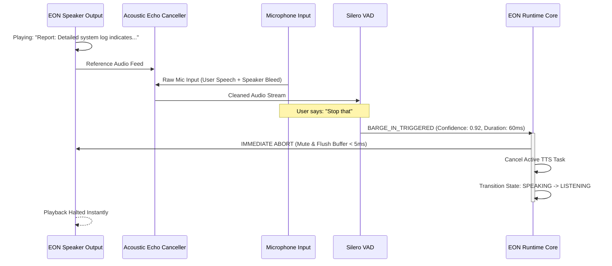

# VOICE PIPELINE SPECIFICATION (STT & TTS)

> **Subsystem:** EON Perception & Speech Engine  
> **Module:** `perception/voice-engine`  
> **Latency Target:** Time-To-First-Audio (TTFA) < 200ms | End-of-Utterance to Token < 80ms

---

## 1. Overview & Latency Architecture

To achieve the seamless conversational presence of **Ciel**, EON cannot use traditional request-response audio architectures that record a full WAV file, upload it to a cloud API, wait for full text, run a cloud LLM, and then wait for an entire audio file to download. That creates a 2.5 to 5-second delay.

EON utilizes an **end-to-end streaming, chunked, duplex audio pipeline** where speech recognition, cognitive routing, and neural voice synthesis run in a continuous streaming cascade.

```
[User Mic]
   │ (16kHz 16-bit PCM Audio Frames - 30ms chunks)
   ▼
┌─────────────────────────┐
│ Silero VAD (30ms chunk) │ ──► [Speech Detected: Confidence > 0.85]
└───────────┬─────────────┘
            │ Continuous Audio Stream
            ▼
┌─────────────────────────────────┐
│ Streaming Zipformer int8 ASR    │ ──► Emits partial tokens every 60ms
└───────────┬─────────────────────┘
            │ End-Of-Utterance (250ms silence) -> Final Utterance
            ▼
┌─────────────────────────────────┐
│ Ciel Cognitive Router (SLM)     │ ──► Streams response tokens instantly
└───────────┬─────────────────────┘
            │ Token Stream: ["Affirmative.", " Analysis", " complete."]
            ▼
┌─────────────────────────────────┐
│ Clause Chunker & Normalizer     │ ──► Sends first clause ("Affirmative.") immediately
└───────────┬─────────────────────┘
            │ Normalized Text Clauses
            ▼
┌─────────────────────────────────┐
│ Kokoro-82M Neural Streaming TTS │ ──► RTF < 0.15 (Generates 1s audio in 150ms on CPU)
└───────────┬─────────────────────┘
            │ 24kHz PCM Audio Buffers
            ▼
[Audio Output Driver (AAudio / WASAPI)] ──► [Speaker] (User hears sound at T+180ms)
```

---

## 2. Low-Latency Speech-to-Text (STT) Subsystem

### 2.1 Voice Activity Detection (VAD)
- **Model**: Silero VAD v5 (ONNX format, quantized int8, model footprint: 2.1 MB).
- **Frame Size**: 30ms (480 samples at 16,000 Hz, 16-bit linear PCM).
- **Processing Time**: < 0.8ms per frame on modern CPU.
- **Dynamic Thresholding**:
  - `start_speech_threshold`: 0.60 confidence score for 2 consecutive frames (60ms).
  - `end_speech_silence_duration`: 250ms of continuous silence below 0.35 confidence.
  - Dynamically lowers to 180ms when the user pauses after a complete syntactic sentence structure.

### 2.2 Streaming ASR Engine
- **Engine**: `sherpa-onnx` runtime with pre-packaged **int8 Streaming Zipformer**.
- **Model Parameters**: Multi-scale Zipformer transducer trained on LibriSpeech + GigaSpeech (streaming encoder chunk size: 32 frames = 160ms hop).
- **Latency**:
  - Emits partial transcripts incrementally every 100ms.
  - Final transcript available within **40ms** of VAD end-of-utterance trigger.
- **Accuracy Fallback**:
  - For complex technical vocabulary, code snippets, or foreign names, a background Moonshine/Whisper-tiny int8 model runs rescoring asynchronously, updating context if a divergence is detected.

---

## 3. Neural Text-to-Speech (TTS) Subsystem

### 3.1 Streaming Neural Model (Kokoro-82M)
- **Architecture**: Kokoro-82M (StyleTTS2 and ISTFTNet-based architecture, 82 million parameters).
- **Quantization**: ONNX FP16 / INT8 optimized for on-device inference via DirectML / CoreML / ONNX Runtime CPU.
- **Sample Rate**: 24,000 Hz, 16-bit mono PCM.
- **Real-Time Factor (RTF)**: **0.12 - 0.18** on standard modern CPU (generates 1 second of audio in ~150ms).
- **Voice Timbre**: Crystalline, calm, authoritative, articulate, and intelligent—matching the Ciel aesthetic.

### 3.2 Token-to-Audio Streaming Pipeline (Clause Chunking)
Traditional TTS systems wait for an entire paragraph before synthesizing speech. EON employs **Incremental Clause Chunking**:
1. Cognitive core streams tokens: `TokenStream("Affirmative.")`, `TokenStream(" Beginning")`, `TokenStream(" build.")`.
2. The `ClauseChunker` splits on punctuation delimiters (`.`, `!`, `?`, `,`, `;`, `:`) or reaches an 8-word chunk boundary.
3. The first chunk `"Affirmative."` is dispatched to Kokoro within **20ms** of the cognitive core's first token.
4. Kokoro produces the first 800ms audio buffer in **50ms**.
5. Audio playback begins at **T+180ms**, while the next clause is synthesized concurrently in the background.

---

## 4. Full Duplex & Acoustic Reflex (Barge-In)

A truly intelligent assistant must allow the user to interrupt at any time without having to wait for the assistant to finish talking.



### Barge-In Invariants:
1. **Zero Audio Lag on Cancellation**: When `BARGE_IN_TRIGGERED` is fired, the audio output buffer is flushed in **< 5ms** via native driver calls.
2. **Cancellation Journaling**: The cancelled speech task is recorded in the event journal as `INTERRUPTED_BY_USER` with the timestamp and token offset.
3. **Seamless State Handover**: The user's interrupting utterance is immediately routed to the Cognitive Core without requiring wake-words.

---

## 5. Audio Buffer Management & Memory Bounds

To prevent memory leaks or audio jitter:
- **Audio Ring Buffer**: Fixed-size circular buffer holding 10 seconds of raw 16kHz audio (320 KB memory footprint).
- **Zero Heap Allocations**: Native audio callbacks reuse pre-allocated `ByteBuffer` arrays; no GC pressure occurs on the audio hot-path.
- **Hardware Integration**:
  - Android: `AAudio` stream in `AAUDIO_PERFORMANCE_MODE_LOW_LATENCY` and `AAUDIO_SHARING_MODE_EXCLUSIVE`.
  - Windows: `WASAPI` in Exclusive Mode with 10ms event-driven buffer periods.

